# Empirical spread of Arctic profiles relative to climatology

Generated by `scripts/05_report_expected_spread.py` from the local NetCDF products in
`outputs/expected_spread/`. See the [technical note](../../technical_note.md) for the
method, the [README](../../README.md) for reproduction, and the
[reference comparison](../woa_compare/woa_compare_report.md) for climatology diagnostics.

## 1. Scope and definitions

The products summarize finite observation-minus-reference differences within each
100 km EASE-Grid 2.0 North cell (EPSG:6931; 180 × 180 cells) and each of the 102 WOA
standard depth levels. The computation selects AOTD scatter profiles from 1992 onward
and pools years and months; there is no time dimension in the output.
Temperature differences use surface-referenced potential temperature (Theta);
salinity differences use practical salinity (S; conventionally reported here as psu).

* **RMSE** = √mean(d²): mismatch relative to the reference, including the mean offset.
* **std** = √mean((d − mean(d))²): population standard deviation after removing the offset.
* **bias** = mean(d), where d = observation − reference. This is a sample mean offset,
  not an independently established climatology error.
* **n** counts finite differences at a cell and depth, not independent observations.
  No minimum count is imposed; std is zero when n = 1.

The `woa23` product uses the profile's calendar month at 0–1500 m and calendar season
below 1500 m. The `aotd` product uses the published monthly AOTD climatology at
0–1500 m only. `woa23_and_aotd` takes the larger finite metric at each cell and level;
when only one reference is available it uses that reference. Below 1500 m it therefore
equals the WOA23 product. Its bias and n follow the selected reference **separately for
std and RMSE**, so the two combined files may have different bias and count fields.

A metric is NaN when no finite comparison is available, including when the reference
is missing. No spatial filling is applied. These empirical summaries are neither pure
observation-error estimates nor validated forecast uncertainties. The combined maximum
is a reference-sensitivity envelope, not a calibrated confidence bound.

## 2. Spread versus depth

Tables and depth curves summarize **each product's own finite cells**, with equal weight
per cell, not per profile. The masks can differ between references and depths; lower
medians do not by themselves establish a better reference. P10–P90 is the spatial
percentile range, not a confidence interval. Counts for all three masks are shown.

**Figure 1. Spatial median RMSE, std and cellwise RMSE/std at 0–1500 m.** Top: Theta; bottom: S. WOA23 shading shows P10–P90 across finite cells. Ratios require n ≥ 5 for both metrics and positive std; the combined ratio can divide metrics selected from different references.

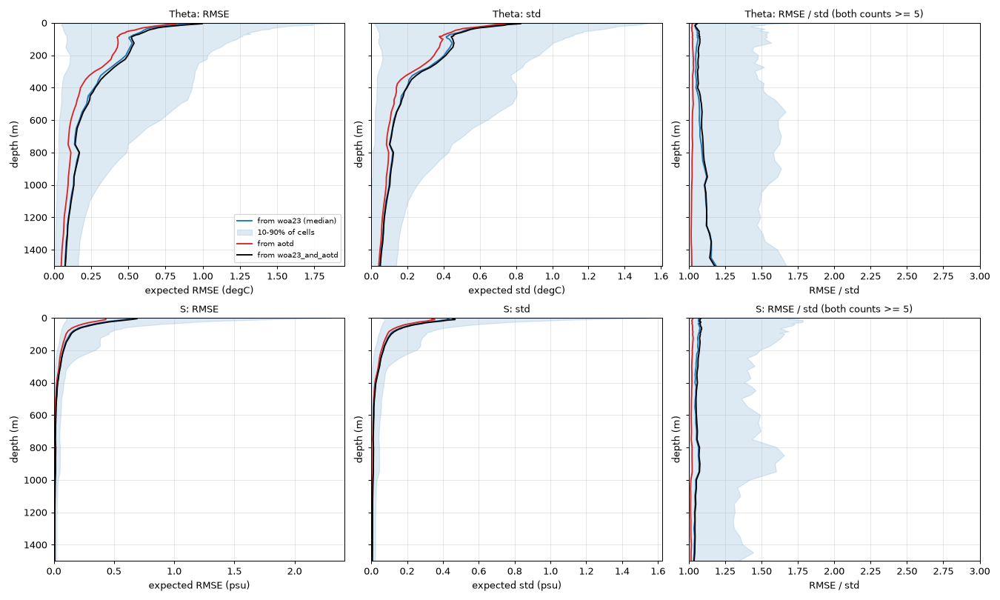

**Figure 2. WOA23-based summaries over 0–5500 m.** As in Figure 1, with a symlog depth axis. Sparse deep sampling should be considered alongside the curves.

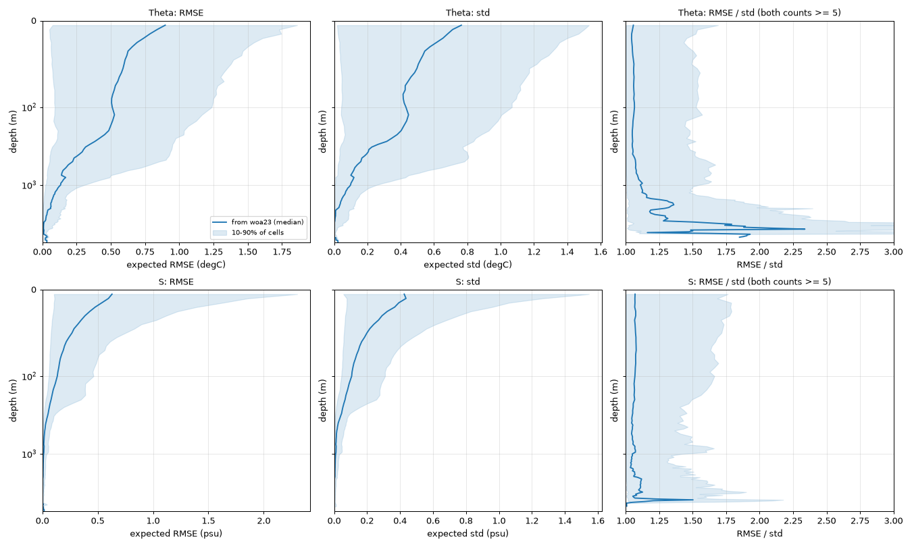

### Theta RMSE (°C)

| depth (m) | woa23 median [P10–P90] | aotd median [P10–P90] | woa23_and_aotd median [P10–P90] | valid cells: WOA23 / AOTD / combined |
|---|---|---|---|---|
| 10 | 0.839 [0.051–1.7] | 0.756 [0.034–1.6] | 0.916 [0.058–1.9] | 1666 / 1672 / 1684 |
| 50 | 0.597 [0.067–1.4] | 0.506 [0.047–1.2] | 0.623 [0.08–1.4] | 1489 / 1481 / 1501 |
| 100 | 0.511 [0.091–1.2] | 0.43 [0.059–1.1] | 0.525 [0.1–1.3] | 1379 / 1366 / 1388 |
| 200 | 0.485 [0.11–1] | 0.394 [0.081–0.93] | 0.498 [0.13–1.1] | 1235 / 1226 / 1247 |
| 500 | 0.221 [0.053–0.85] | 0.151 [0.035–0.8] | 0.231 [0.058–0.91] | 907 / 904 / 913 |
| 1000 | 0.134 [0.022–0.31] | 0.096 [0.014–0.25] | 0.135 [0.027–0.31] | 664 / 661 / 668 |
| 1500 | 0.0756 [0.011–0.17] | 0.0503 [0.0057–0.13] | 0.0773 [0.014–0.17] | 579 / 572 / 583 |
| 2500 | 0.0286 [0.0029–0.13] | – | 0.0286 [0.0029–0.13] | 337 / 0 / 337 |
| 4000 | 0.0106 [0.0028–0.031] | – | 0.0106 [0.0028–0.031] | 35 / 0 / 35 |

### Theta std (°C)

| depth (m) | woa23 median [P10–P90] | aotd median [P10–P90] | woa23_and_aotd median [P10–P90] | valid cells: WOA23 / AOTD / combined |
|---|---|---|---|---|
| 10 | 0.712 [0.021–1.5] | 0.688 [0.016–1.5] | 0.754 [0.026–1.6] | 1666 / 1672 / 1684 |
| 50 | 0.506 [0.039–1.2] | 0.458 [0.032–1.1] | 0.525 [0.042–1.2] | 1489 / 1481 / 1501 |
| 100 | 0.432 [0.043–1.1] | 0.396 [0.038–0.97] | 0.45 [0.049–1.1] | 1379 / 1366 / 1388 |
| 200 | 0.403 [0.061–0.93] | 0.347 [0.056–0.83] | 0.412 [0.067–0.94] | 1235 / 1226 / 1247 |
| 500 | 0.161 [0.028–0.78] | 0.126 [0.024–0.73] | 0.163 [0.035–0.8] | 907 / 904 / 913 |
| 1000 | 0.099 [0.0038–0.26] | 0.0829 [0.0026–0.24] | 0.103 [0.0062–0.26] | 664 / 661 / 668 |
| 1500 | 0.0471 [0–0.14] | 0.0413 [0–0.13] | 0.0501 [0–0.14] | 579 / 572 / 583 |
| 2500 | 0.00859 [0–0.087] | – | 0.00859 [0–0.087] | 337 / 0 / 337 |
| 4000 | 0.000586 [0–0.0094] | – | 0.000586 [0–0.0094] | 35 / 0 / 35 |

### S RMSE (psu)

| depth (m) | woa23 median [P10–P90] | aotd median [P10–P90] | woa23_and_aotd median [P10–P90] | valid cells: WOA23 / AOTD / combined |
|---|---|---|---|---|
| 10 | 0.597 [0.11–1.9] | 0.433 [0.089–1.2] | 0.639 [0.11–2] | 1666 / 1672 / 1684 |
| 50 | 0.268 [0.078–0.75] | 0.193 [0.063–0.49] | 0.285 [0.083–0.79] | 1489 / 1481 / 1501 |
| 100 | 0.135 [0.059–0.46] | 0.103 [0.046–0.32] | 0.144 [0.061–0.48] | 1379 / 1366 / 1388 |
| 200 | 0.0793 [0.03–0.35] | 0.0636 [0.025–0.24] | 0.0822 [0.034–0.36] | 1235 / 1226 / 1247 |
| 500 | 0.022 [0.0045–0.066] | 0.0159 [0.0032–0.057] | 0.0229 [0.0046–0.069] | 907 / 904 / 913 |
| 1000 | 0.0117 [0.0035–0.039] | 0.00873 [0.0016–0.03] | 0.012 [0.0041–0.039] | 664 / 661 / 668 |
| 1500 | 0.00779 [0.0023–0.027] | 0.00566 [0.0011–0.023] | 0.00812 [0.0026–0.028] | 579 / 572 / 583 |
| 2500 | 0.00434 [0.0012–0.021] | – | 0.00434 [0.0012–0.021] | 337 / 0 / 337 |
| 4000 | 0.00179 [0.0004–0.0082] | – | 0.00179 [0.0004–0.0082] | 35 / 0 / 35 |

### S std (psu)

| depth (m) | woa23 median [P10–P90] | aotd median [P10–P90] | woa23_and_aotd median [P10–P90] | valid cells: WOA23 / AOTD / combined |
|---|---|---|---|---|
| 10 | 0.436 [0.077–1.3] | 0.355 [0.068–1] | 0.468 [0.079–1.4] | 1666 / 1672 / 1684 |
| 50 | 0.199 [0.06–0.52] | 0.165 [0.05–0.43] | 0.212 [0.064–0.53] | 1489 / 1481 / 1501 |
| 100 | 0.107 [0.044–0.31] | 0.0909 [0.039–0.27] | 0.112 [0.048–0.32] | 1379 / 1366 / 1388 |
| 200 | 0.0666 [0.02–0.26] | 0.057 [0.018–0.2] | 0.068 [0.022–0.26] | 1235 / 1226 / 1247 |
| 500 | 0.0167 [0.0029–0.059] | 0.014 [0.0021–0.054] | 0.0174 [0.0033–0.06] | 907 / 904 / 913 |
| 1000 | 0.00975 [0.00051–0.033] | 0.00769 [0.0004–0.028] | 0.00992 [0.0011–0.033] | 664 / 661 / 668 |
| 1500 | 0.00592 [0–0.024] | 0.00484 [0–0.022] | 0.00599 [0–0.025] | 579 / 572 / 583 |
| 2500 | 0.00234 [0–0.01] | – | 0.00234 [0–0.01] | 337 / 0 / 337 |
| 4000 | 0.00056 [0–0.0046] | – | 0.00056 [0–0.0046] | 35 / 0 / 35 |

## 3. Spatial distributions

The overview figures show Theta and S metrics at 10, 100 and 1500 m, log10 counts,
and depth summaries. Count maps describe the available comparisons, not an effective
sample size. Colour scales are panel-specific; consult the colour bars before comparing
magnitudes. The maps describe spatial structure but do not separate the processes
responsible for it.

| reference | std | RMSE |
|---|---|---|
| WOA23 | 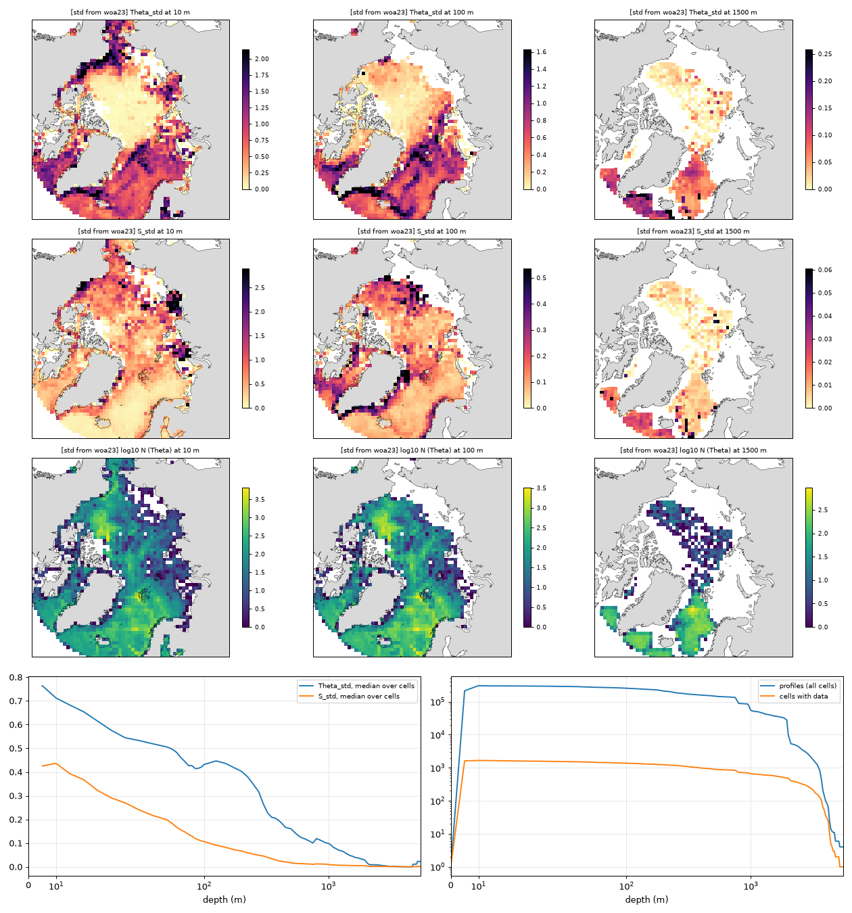 | 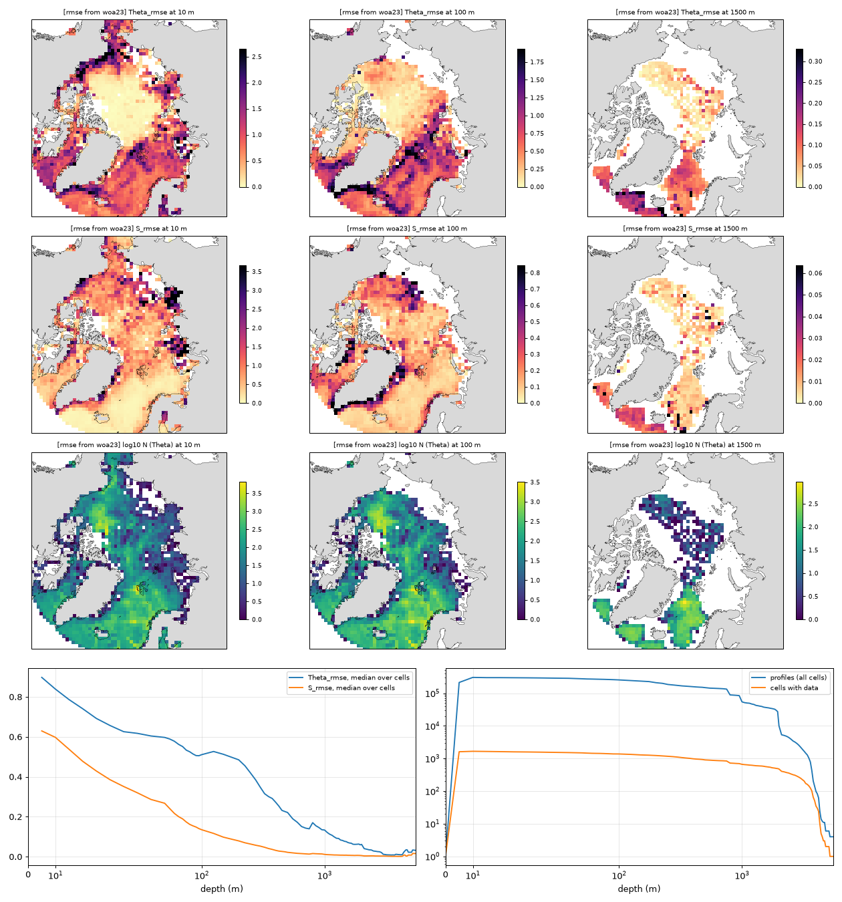 |
| AOTD | 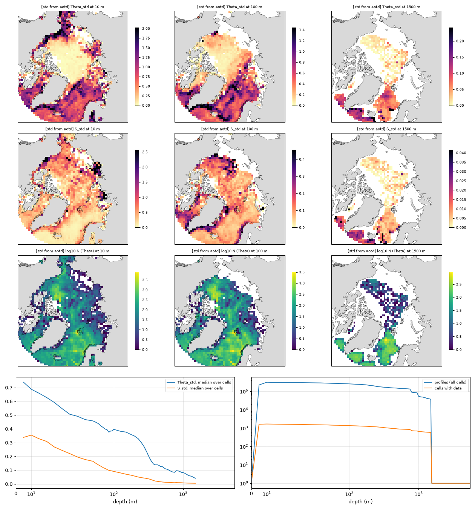 | 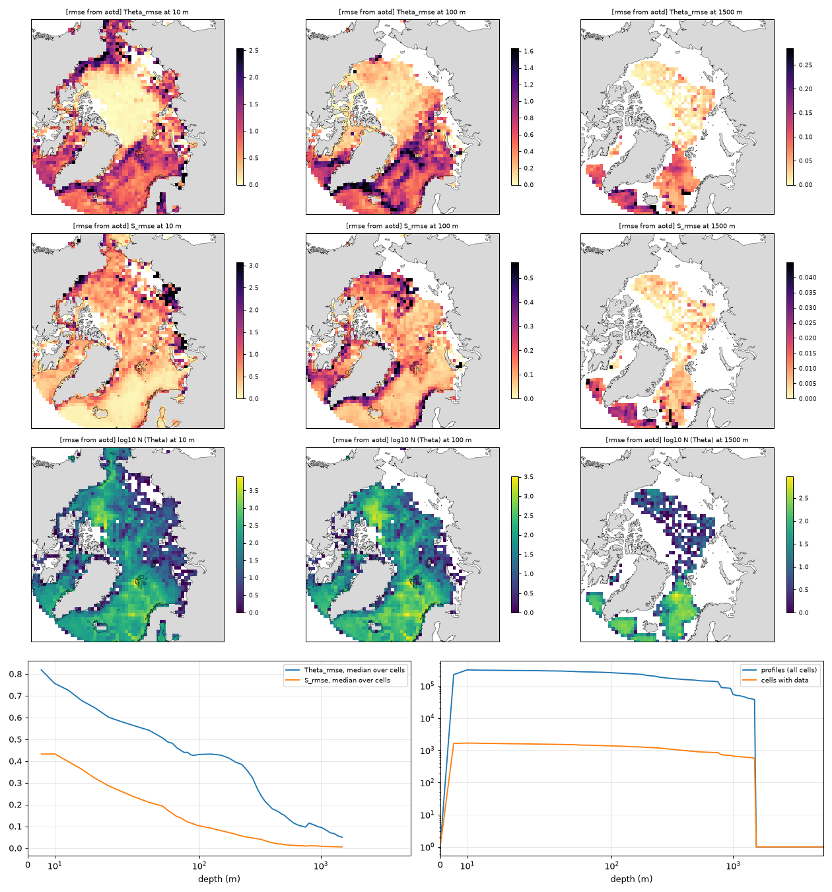 |
| Combined maximum | 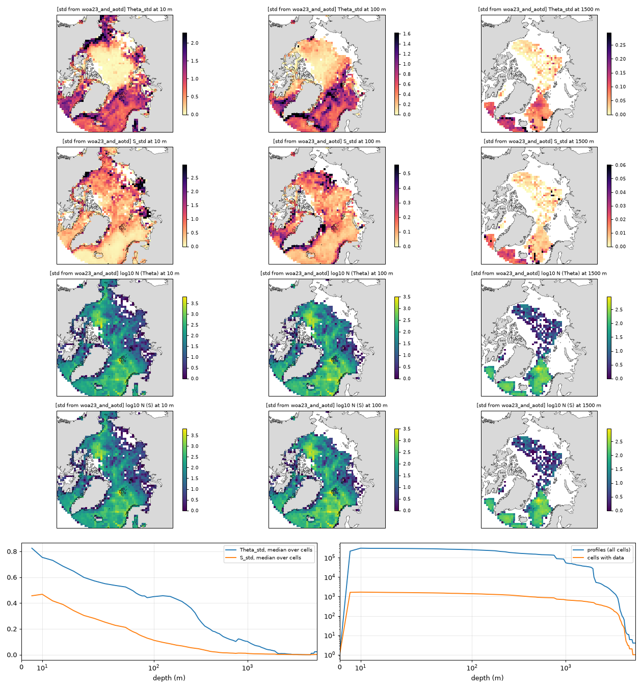 | 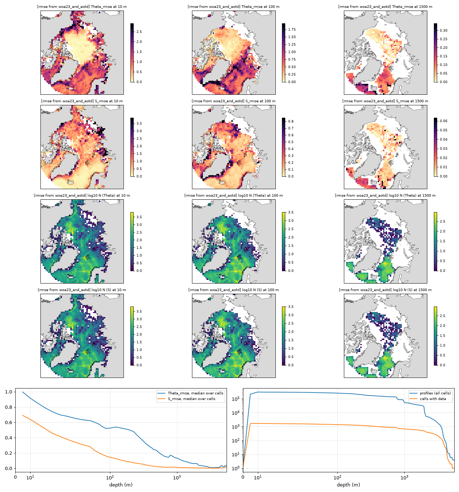 |

## 4. Mean offsets and reference sensitivity

**Figure 3. Mean observation-minus-WOA23 offsets at 10, 100 and 1500 m.** Each symmetric colour range is set by the 98th percentile of the absolute cell offset.

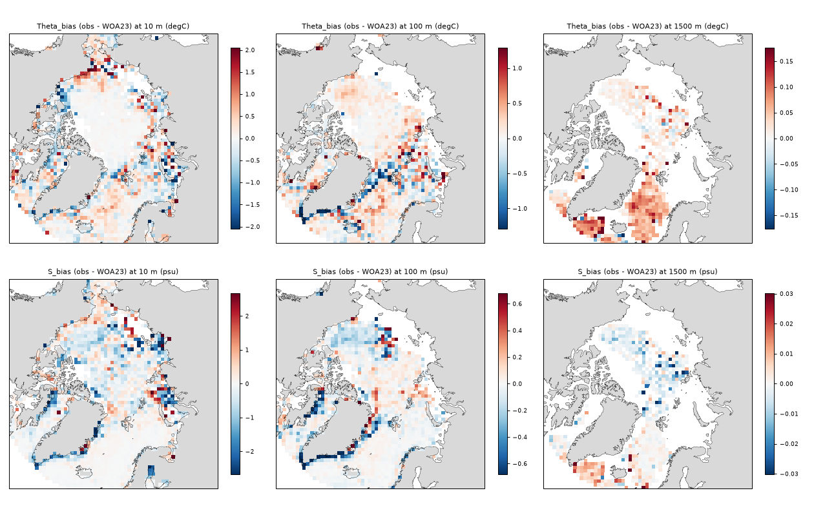

| depth (m) | Theta bias median (°C) | Theta bias P10–P90 | S bias median (psu) | S bias P10–P90 |
|---|---|---|---|---|
| 10 | 0.00775 | -0.62 … 0.56 | -0.0264 | -0.88 … 0.42 |
| 50 | 0.0297 | -0.35 … 0.47 | -0.0107 | -0.44 … 0.19 |
| 100 | 0.0369 | -0.32 … 0.39 | -0.00953 | -0.22 … 0.097 |
| 200 | 0.0213 | -0.29 … 0.34 | -0.00609 | -0.14 … 0.057 |
| 500 | 0.0259 | -0.15 … 0.23 | -0.00112 | -0.024 … 0.011 |
| 1000 | 0.0331 | -0.059 … 0.13 | -0.000285 | -0.013 … 0.0064 |
| 1500 | 0.03 | -0.0089 … 0.096 | -0.000248 | -0.0089 … 0.0076 |
| 2500 | 0.00243 | -0.023 … 0.083 | -0.000889 | -0.0065 … 0.0045 |
| 4000 | -0.00251 | -0.014 … 0.031 | -0.000238 | -0.0061 … 0.0025 |

**Figure 4. AOTD-based RMSE minus WOA23-based RMSE where both metrics exist.** Blue denotes a smaller empirical AOTD-based RMSE, not independent validation of AOTD. Even within a shared output cell, the contributing observations can differ because the reference masks differ.

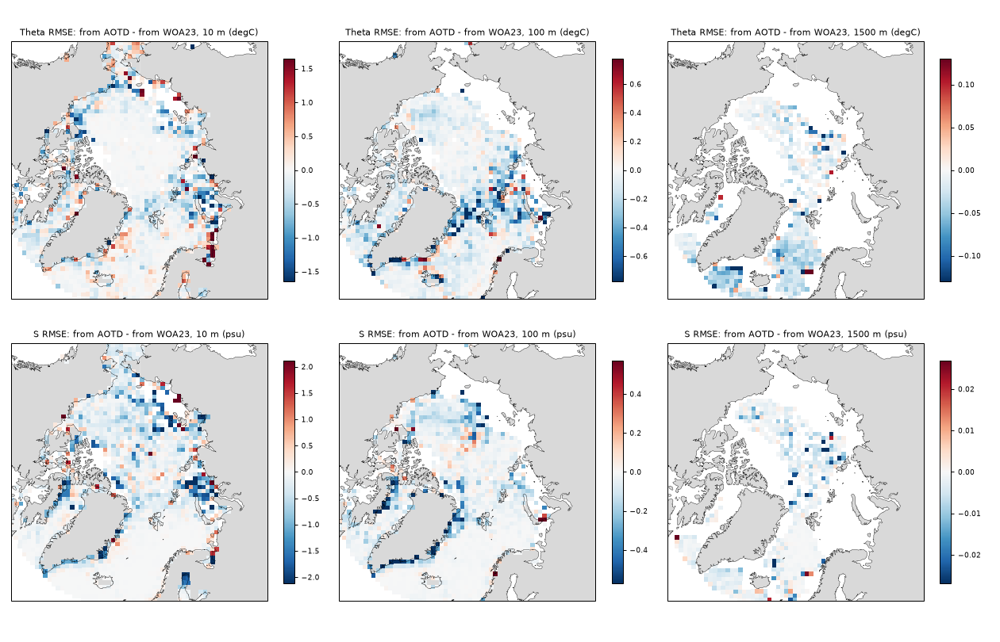

## 5. Available comparisons

**Figure 5. WOA23-based potential-temperature comparison counts versus depth.** Panels show total finite differences, cells with data, and sparse-cell percentages conditional on n > 0. These counts need not describe salinity or the other products.

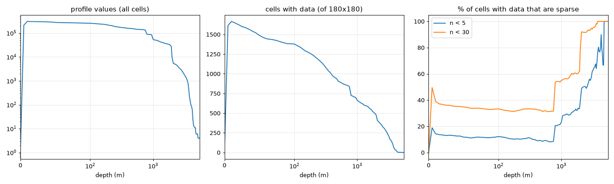

| depth (m) | values used | cells with data | % of valid cells with n < 5 | % with n < 30 |
|---|---|---|---|---|
| 10 | 306,331 | 1666 | 14.3 | 39 |
| 50 | 278,124 | 1489 | 11.8 | 34.7 |
| 100 | 256,455 | 1379 | 12.2 | 33.3 |
| 200 | 210,761 | 1235 | 10.4 | 32 |
| 500 | 148,954 | 907 | 8.6 | 31.3 |
| 1000 | 54,635 | 664 | 23 | 55 |
| 1500 | 37,597 | 579 | 30.9 | 60.1 |
| 2500 | 3,937 | 337 | 49 | 91.7 |
| 4000 | 98 | 35 | 77.1 | 100 |

Sparse cells have poorly constrained statistics; a singleton's zero std does not imply
zero physical variability. Repeated measurements along tracks or sections can be
correlated, so larger n does not guarantee proportionally more independent information.

## 6. Interpretation and limitations

* Mismatch combines observational uncertainty, unresolved spatial and temporal
  variability, interannual change, trends, and reference limitations. This analysis
  does not identify their individual contributions.
* For a single reference and the same samples, RMSE² = std² + bias². This identity
  need not hold across the separately selected combined std and RMSE products.
* AOTD scatter and climatology share source data; the extent of overlap with WOA23
  is not established here. Smaller mismatch is not an out-of-sample skill estimate.
* Reference lookup uses a 0.25° cell without spatial or temporal interpolation.
  AOTD is mapped to WOA23 centres under an adopted grid-alignment assumption.
* The [climatology comparison](../woa_compare/woa_compare_report.md) documents a
  marked deep-salinity disagreement in ten AOTD months. It warrants investigation
  but does not independently establish which reference is correct.
* Applying these pooled spreads to assimilation or prediction requires additional
  validation, sampling safeguards and a treatment of correlated errors.

## 7. Data and provenance

[Level statistics](tables/level_statistics.csv) contains finite-cell counts, medians
and P10/P90 for each level and product. Its `bias` rows use the **RMSE file's** bias
field, including for the combined product; the combined std file may contain another
reference's bias. The figures are generated by `scripts/04_make_plots.py`.

NetCDF products follow
`expected_{std,rmse}_from_{woa23,aotd,woa23_and_aotd}_{potential_temperature,salinity}_ease2_100km.nc`
in `outputs/expected_spread/` (12 files). Each contains the metric, bias, n, coordinates
and CRS metadata; regenerate them with `scripts/03_compute_expected_spread.py`.

Source credit: Li, J., Wu, X. & Wang, X. (2025), *An Arctic Ocean Thermohaline Dataset*,
[doi:10.1038/s41597-025-05855-3](https://doi.org/10.1038/s41597-025-05855-3);
AOTD scatter (CC BY 4.0),
[doi:10.6084/m9.figshare.28825490.v1](https://doi.org/10.6084/m9.figshare.28825490.v1);
AOTD climatology,
[doi:10.6084/m9.figshare.27645738.v1](https://doi.org/10.6084/m9.figshare.27645738.v1).
WOA23 temperature and salinity are NOAA NCEI products; full references are in the
[technical note](../../technical_note.md#references).
