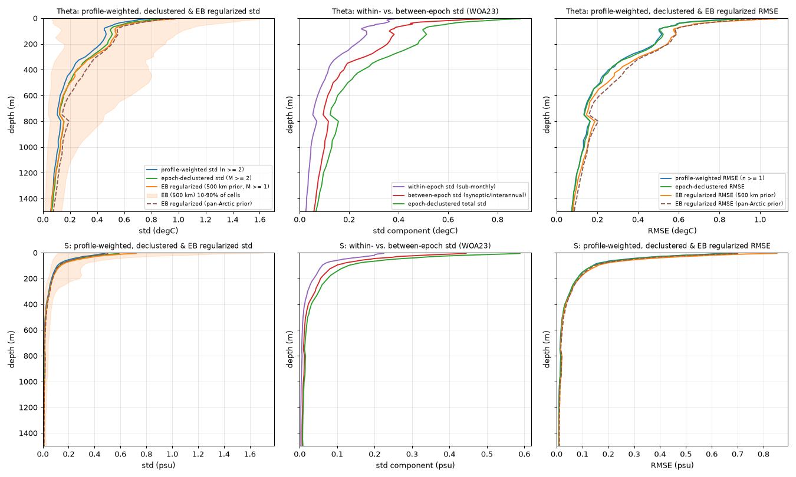
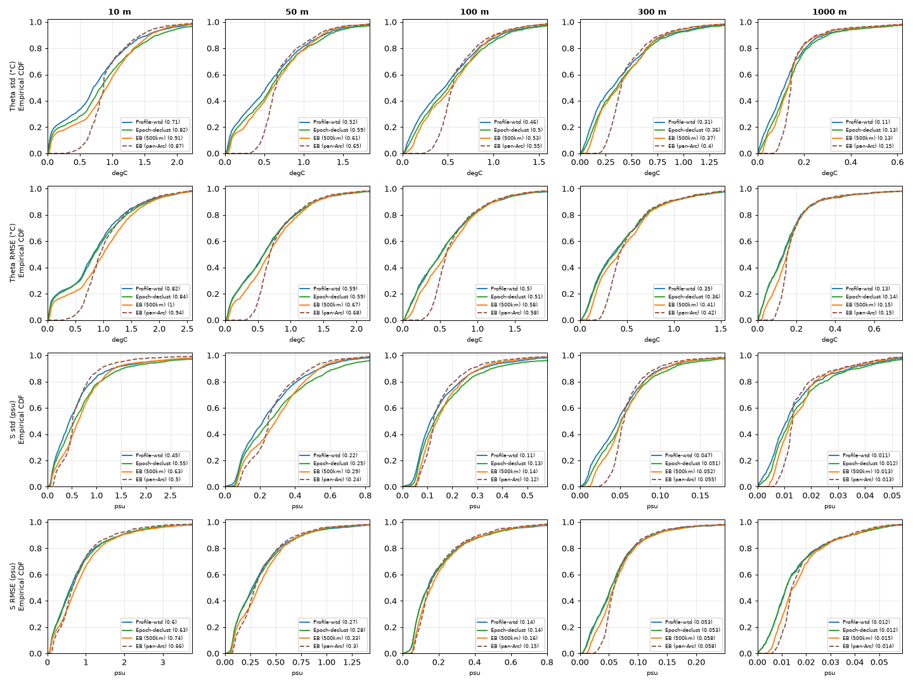
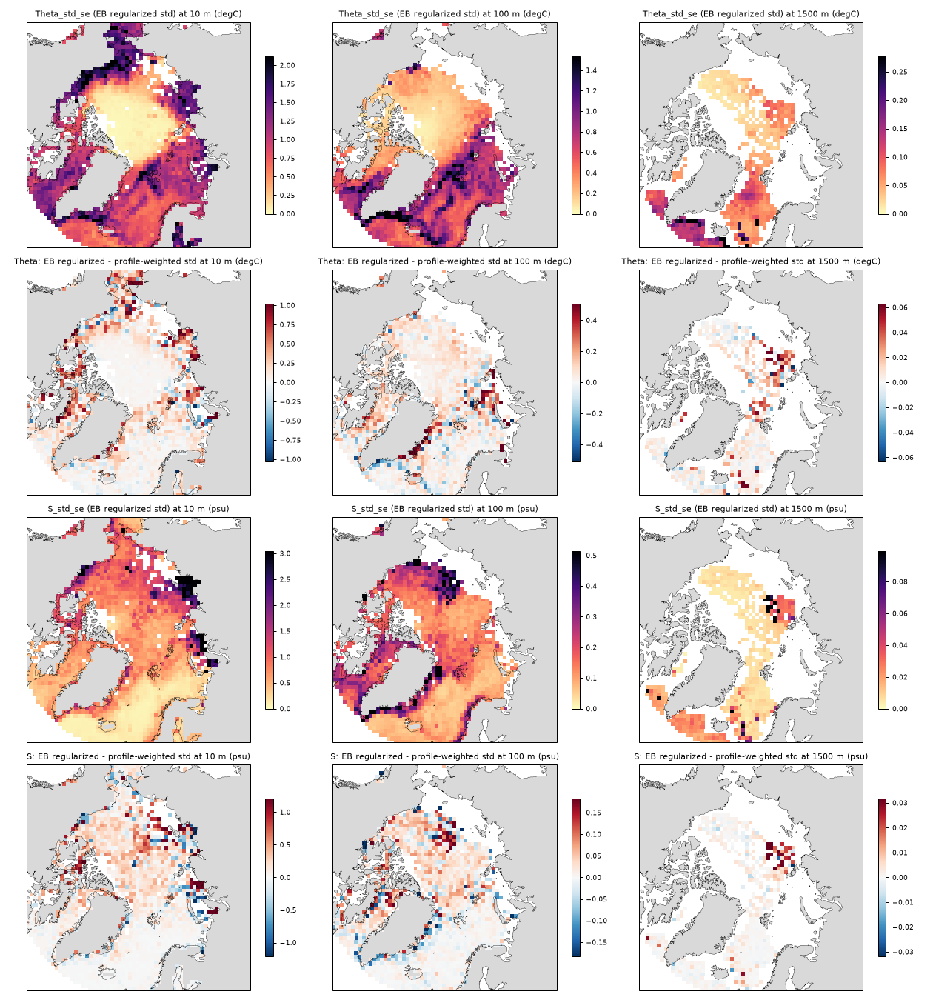
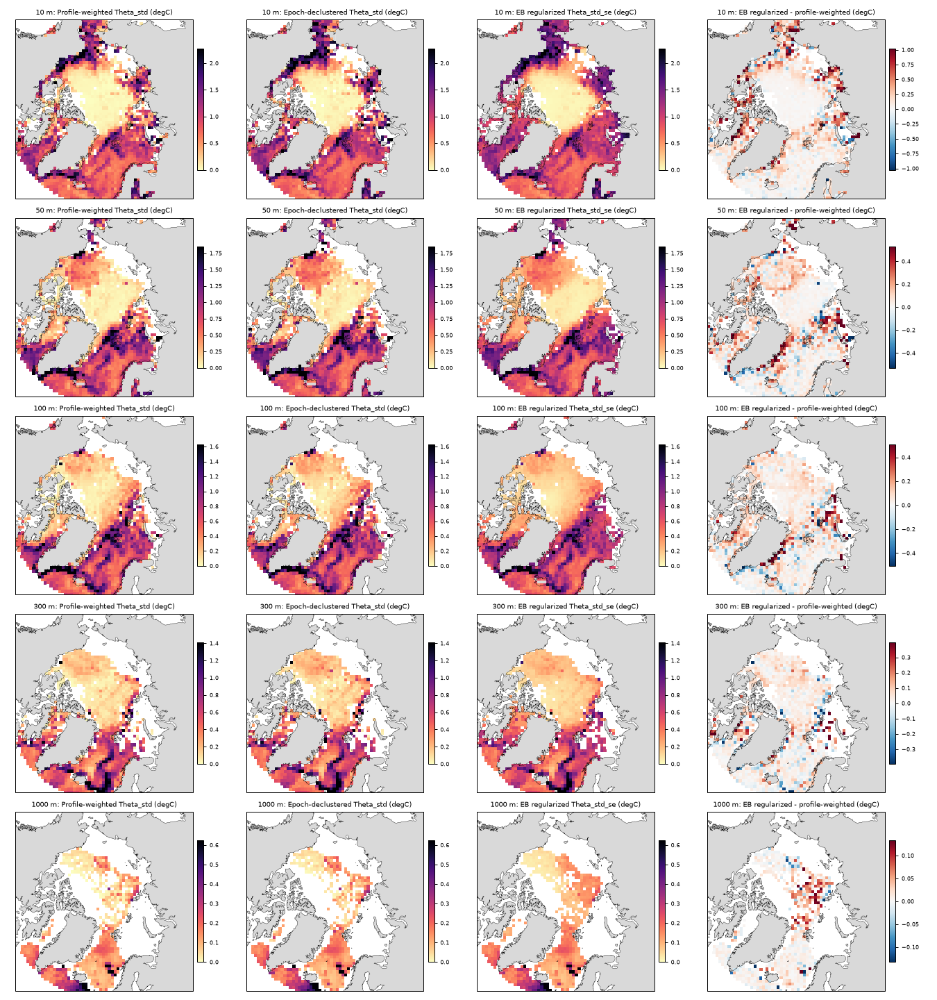
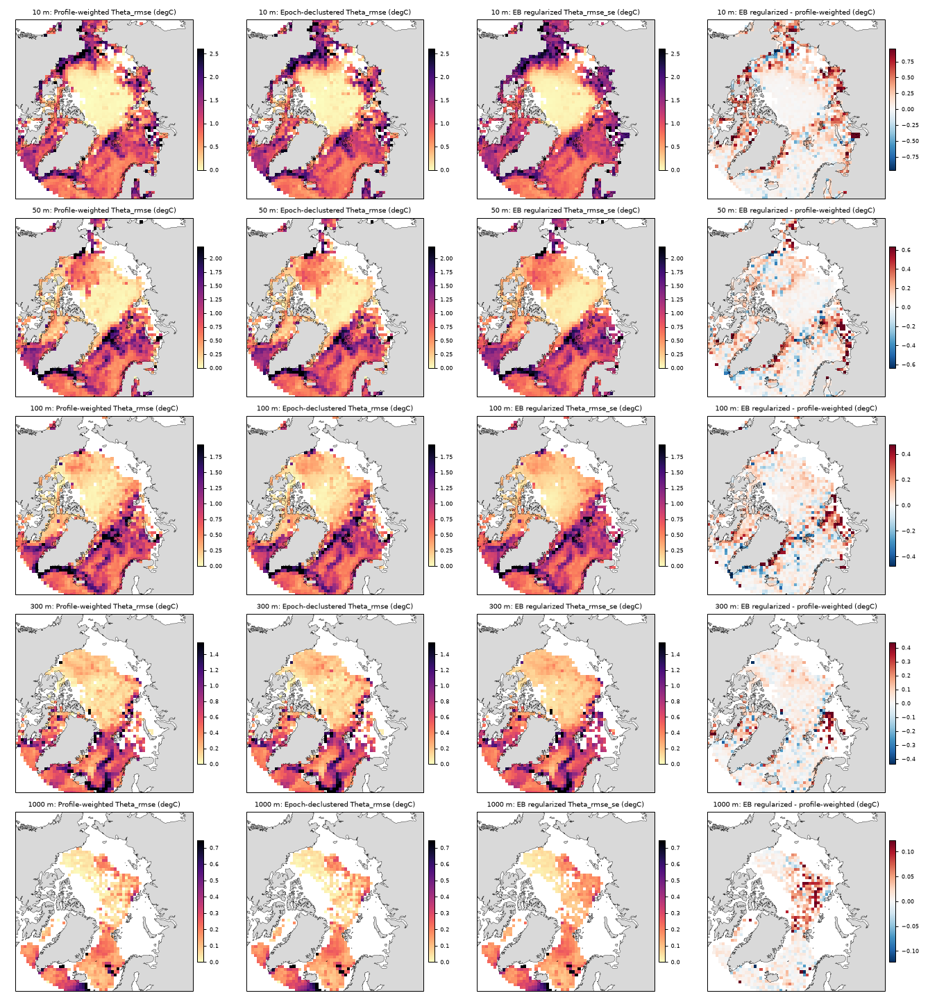
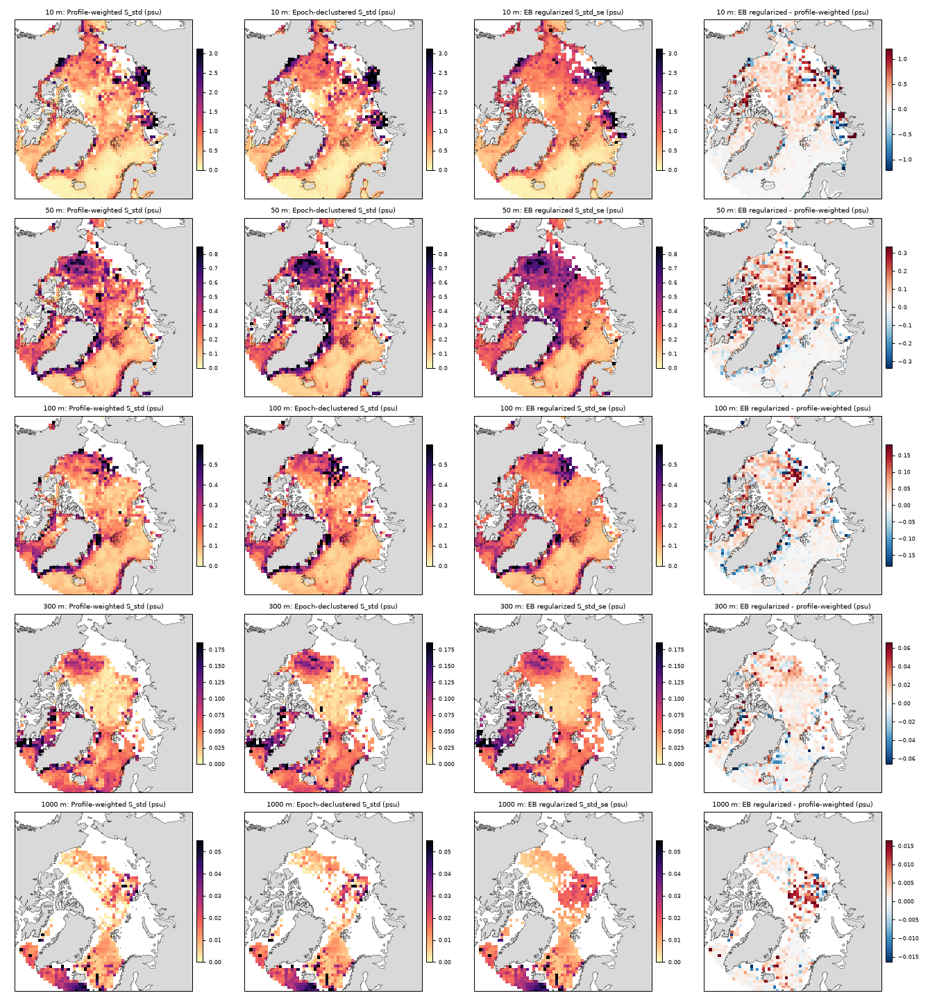
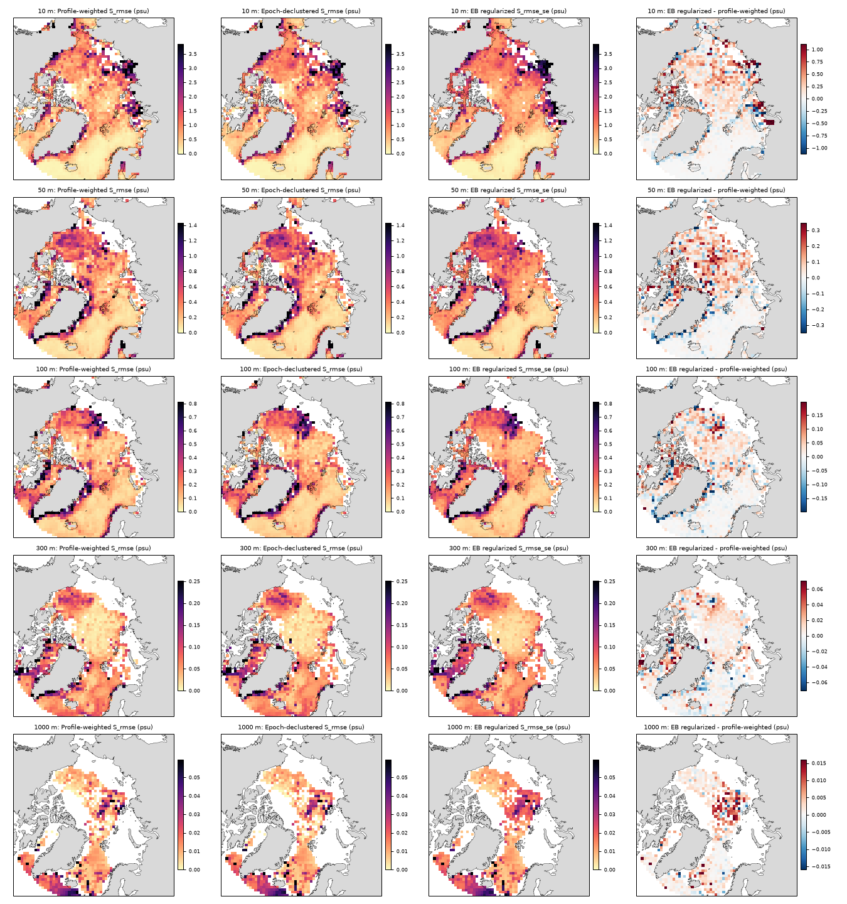
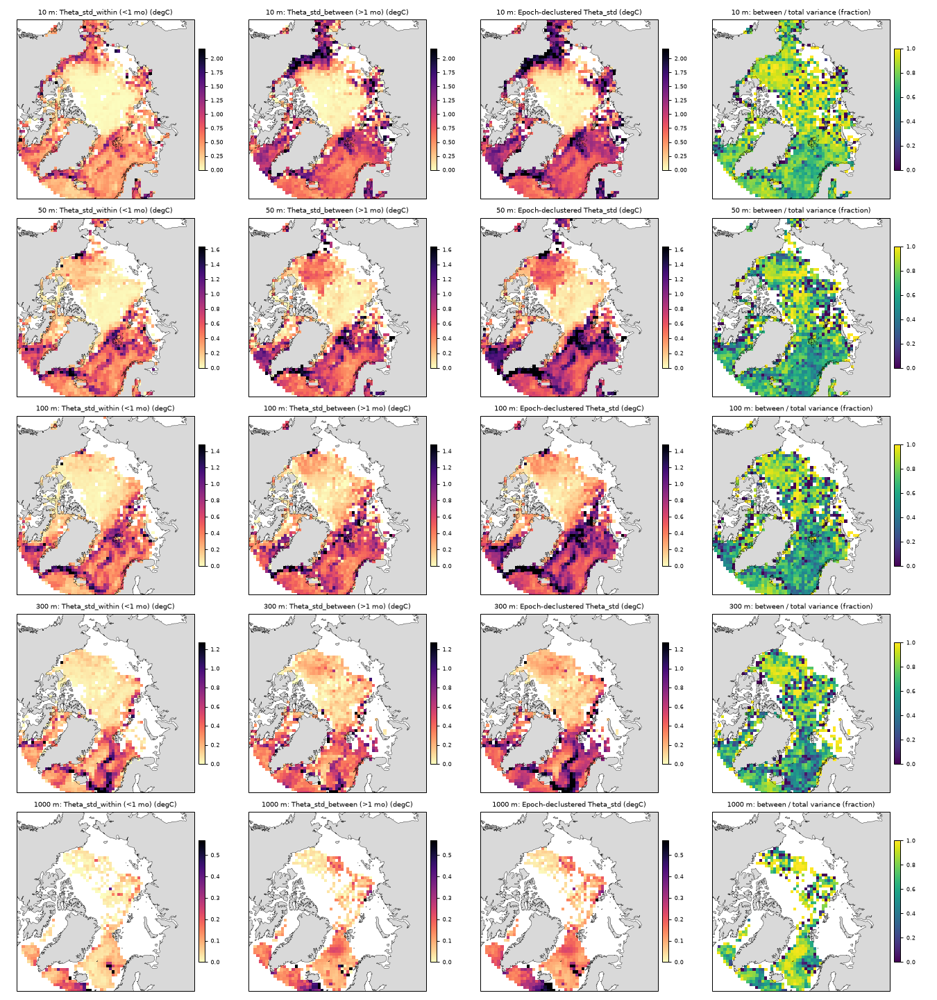
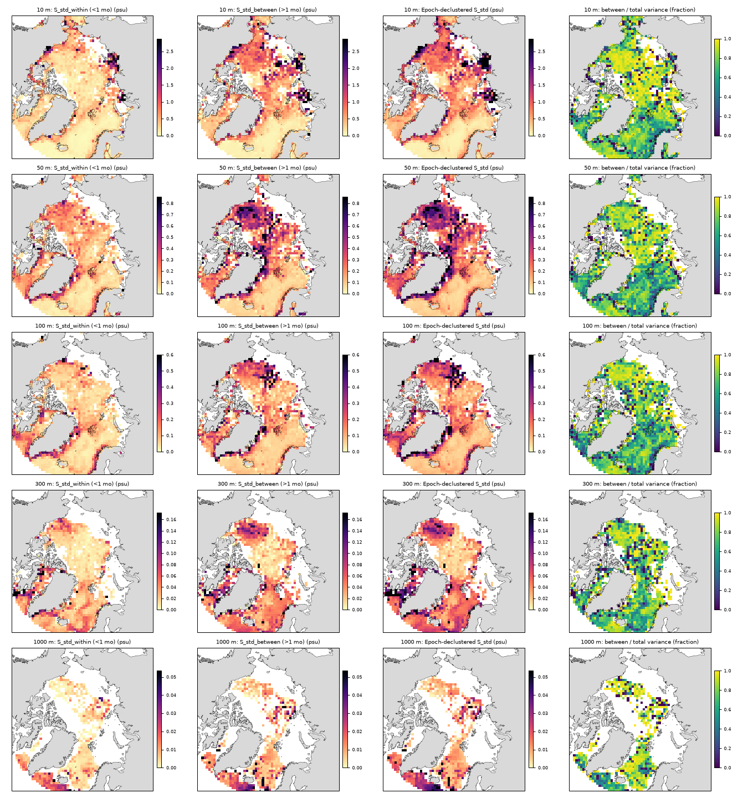

# Empirical spread of Arctic profiles relative to climatology

Generated by `scripts/05_report_expected_spread.py` from the local NetCDF products in
`outputs/expected_spread/`. See the [technical note](../../technical_note.md) for the
method, the [README](../../README.md) for reproduction, and the
[reference comparison](../woa_compare/woa_compare_report.md) for climatology diagnostics.

## 1. Scope and definitions

The products summarize finite observation-minus-reference differences within each
100 km EASE-Grid 2.0 North cell (EPSG:6931; 180 × 180 cells) and each of the 102 WOA
standard depth levels. The computation selects AOTD scatter profiles from 1992 onward
and pools years and months; there is no time dimension in the output.
Temperature differences use surface-referenced potential temperature (Theta);
salinity differences use practical salinity (S; conventionally reported here as psu).

* **Profile-weighted fields (`*_rmse`, `*_std`, `*_bias`)**:
  assign equal weight (`1 / n`) to every finite comparison value:
  * **RMSE** = √mean(d²): profile-weighted mismatch relative to the reference, including the mean offset (defined when `n >= 1`).
  * **std** = √(n / (n − 1) · mean((d − mean(d))²)): profile-weighted **sample** standard deviation (`ddof=1`) after removing the cell's mean offset. It is `NaN` when `n < 2`, preventing zero-variance artifacts in singleton cells.
  * **bias** = mean(d), where d = observation − reference. This is a sample mean offset, not an independently established climatology error.
* **Epoch-declustered fields (`*_std_declustered`, `*_rmse_declustered`, `*_bias_declustered`, `*_std_within`, `*_std_between`)**:
  group observations in each 100 km cell and depth into **1-month synoptic epochs** `(cell, year, month)` (count `M = n_epochs`),
  assigning equal weight `1 / M` to each epoch and restoring pooled within-epoch variance via the Law of Total Variance.
* **Empirical Bayes (EB) state-estimation regularized fields (`*_std_se`, `*_rmse_se`) and pan-Arctic comparison (`*_std_se_pan_arctic`, `*_rmse_se_pan_arctic`)**:
  apply Empirical Bayes shrinkage (`nu_0 = 5` epochs) of the epoch-declustered variance toward a **500 km circular moving-window median prior** across neighboring well-sampled cells (`M >= 5`, with fallback to `M >= 2` within 500 km and then the depth-level median), providing a regime-preserving, non-degenerate error estimate for every sampled cell (`M >= 1`). For comparison, `*_se_pan_arctic` shrinks toward a single horizontally uniform pan-Arctic depth-level prior.
* **n** counts finite differences at a cell and depth, **n_eff** counts distinct `(100 km cell, UTC calendar day)` sampling days, **n_epochs** (`M`) counts distinct `(100 km cell, year, month)` 1-month synoptic epochs, and **n_years** counts distinct calendar years (1992–2023) represented in the cell.

The `woa23` product uses the WOA23 0.25° monthly climatology at 0–1500 m and seasonal
climatology below 1500 m, **bilinearly interpolated in space and linearly interpolated in time**
(between mid-months or mid-seasons, with coast/mask-aware weight renormalization over finite corners).
The `aotd` product uses the published monthly AOTD climatology at 0–1500 m only, interpolated identically.
`woa23_and_aotd` takes the larger finite metric at each cell and level;
when only one reference is available it uses that reference. Below 1500 m it therefore
equals the WOA23 product. Its `bias`, `n`, `n_eff` and `n_years` follow the selected reference **separately for
std and RMSE**, so the two combined files may have different bias and count fields.

A metric is NaN when insufficient finite comparisons are available (`n < 1` for RMSE, `n < 2` for sample std), including when the reference
is missing. No spatial filling of the output spread grid is applied. These empirical summaries are neither pure
observation-error estimates nor validated forecast uncertainties. The combined maximum
is a reference-sensitivity envelope, not a calibrated confidence bound.

## 2. Spread versus depth

Tables and depth curves summarize **each product's own finite cells**, with equal weight
per cell, not per profile. The masks can differ between references and depths; lower
medians do not by themselves establish a better reference. P10–P90 is the spatial
percentile range, not a confidence interval. Counts for all three masks are shown.

**Figure 1. Spatial median RMSE, std and cellwise RMSE/std at 0–1500 m.** Top: Theta; bottom: S. WOA23 shading shows P10–P90 across finite cells. Ratios require n ≥ 5 for both metrics and positive std; the combined ratio can divide metrics selected from different references.

**Figure 2. WOA23-based summaries over 0–5500 m.** As in Figure 1, with a symlog depth axis. Sparse deep sampling should be considered alongside the curves.

### Theta RMSE (°C)

| depth (m) | woa23 median [P10–P90] | aotd median [P10–P90] | woa23_and_aotd median [P10–P90] | valid cells: WOA23 / AOTD / combined |
|---|---|---|---|---|
| 10 | 0.819 [0.048–1.8] | 0.765 [0.038–1.7] | 0.899 [0.058–1.9] | 1694 / 1703 / 1707 |
| 50 | 0.592 [0.068–1.4] | 0.515 [0.051–1.2] | 0.614 [0.083–1.4] | 1508 / 1511 / 1520 |
| 100 | 0.504 [0.097–1.2] | 0.442 [0.063–1.1] | 0.522 [0.11–1.3] | 1393 / 1390 / 1403 |
| 200 | 0.483 [0.12–1] | 0.407 [0.088–0.95] | 0.498 [0.13–1.1] | 1256 / 1256 / 1269 |
| 500 | 0.214 [0.051–0.89] | 0.162 [0.037–0.83] | 0.223 [0.056–0.91] | 925 / 923 / 927 |
| 1000 | 0.133 [0.024–0.31] | 0.101 [0.017–0.28] | 0.136 [0.029–0.32] | 673 / 668 / 673 |
| 1500 | 0.074 [0.013–0.17] | 0.0499 [0.0075–0.14] | 0.0759 [0.015–0.17] | 587 / 586 / 591 |
| 2500 | 0.0327 [0.0034–0.13] | – | 0.0327 [0.0034–0.13] | 347 / 0 / 347 |
| 4000 | 0.011 [0.0022–0.033] | – | 0.011 [0.0022–0.033] | 38 / 0 / 38 |

### Theta std (°C)

| depth (m) | woa23 median [P10–P90] | aotd median [P10–P90] | woa23_and_aotd median [P10–P90] | valid cells: WOA23 / AOTD / combined |
|---|---|---|---|---|
| 10 | 0.709 [0.036–1.5] | 0.7 [0.03–1.5] | 0.773 [0.04–1.6] | 1608 / 1615 / 1618 |
| 50 | 0.524 [0.052–1.3] | 0.488 [0.047–1.2] | 0.538 [0.058–1.3] | 1435 / 1437 / 1443 |
| 100 | 0.462 [0.067–1.1] | 0.418 [0.052–1] | 0.473 [0.074–1.1] | 1334 / 1334 / 1340 |
| 200 | 0.425 [0.085–0.94] | 0.372 [0.075–0.87] | 0.434 [0.092–0.95] | 1201 / 1208 / 1213 |
| 500 | 0.163 [0.035–0.79] | 0.138 [0.033–0.75] | 0.171 [0.039–0.8] | 895 / 893 / 895 |
| 1000 | 0.115 [0.019–0.28] | 0.0998 [0.016–0.27] | 0.116 [0.021–0.29] | 623 / 621 / 623 |
| 1500 | 0.0585 [0.0084–0.15] | 0.0524 [0.0054–0.14] | 0.0607 [0.0091–0.15] | 524 / 524 / 527 |
| 2500 | 0.022 [0.0019–0.1] | – | 0.022 [0.0019–0.1] | 286 / 0 / 286 |
| 4000 | 0.0032 [0.00018–0.016] | – | 0.0032 [0.00018–0.016] | 22 / 0 / 22 |

### S RMSE (psu)

| depth (m) | woa23 median [P10–P90] | aotd median [P10–P90] | woa23_and_aotd median [P10–P90] | valid cells: WOA23 / AOTD / combined |
|---|---|---|---|---|
| 10 | 0.596 [0.11–1.9] | 0.463 [0.097–1.3] | 0.658 [0.12–2] | 1694 / 1703 / 1707 |
| 50 | 0.269 [0.079–0.75] | 0.205 [0.068–0.51] | 0.291 [0.083–0.79] | 1508 / 1511 / 1520 |
| 100 | 0.141 [0.059–0.46] | 0.109 [0.05–0.33] | 0.146 [0.061–0.48] | 1393 / 1390 / 1403 |
| 200 | 0.0796 [0.031–0.34] | 0.0664 [0.027–0.25] | 0.0838 [0.034–0.36] | 1256 / 1256 / 1269 |
| 500 | 0.0222 [0.0048–0.068] | 0.0177 [0.0035–0.06] | 0.0231 [0.0049–0.069] | 925 / 923 / 927 |
| 1000 | 0.0118 [0.0038–0.038] | 0.00903 [0.0027–0.031] | 0.012 [0.0043–0.038] | 673 / 668 / 673 |
| 1500 | 0.0088 [0.0028–0.029] | 0.00579 [0.0016–0.023] | 0.0091 [0.0035–0.029] | 587 / 586 / 591 |
| 2500 | 0.00489 [0.0014–0.029] | – | 0.00489 [0.0014–0.029] | 347 / 0 / 347 |
| 4000 | 0.00251 [0.00067–0.0086] | – | 0.00251 [0.00067–0.0086] | 38 / 0 / 38 |

### S std (psu)

| depth (m) | woa23 median [P10–P90] | aotd median [P10–P90] | woa23_and_aotd median [P10–P90] | valid cells: WOA23 / AOTD / combined |
|---|---|---|---|---|
| 10 | 0.448 [0.094–1.3] | 0.388 [0.087–1.1] | 0.484 [0.099–1.4] | 1608 / 1615 / 1618 |
| 50 | 0.218 [0.073–0.54] | 0.179 [0.065–0.44] | 0.225 [0.075–0.55] | 1435 / 1437 / 1443 |
| 100 | 0.112 [0.052–0.32] | 0.0988 [0.046–0.28] | 0.117 [0.055–0.33] | 1334 / 1334 / 1340 |
| 200 | 0.0688 [0.025–0.26] | 0.061 [0.022–0.22] | 0.0701 [0.027–0.26] | 1201 / 1208 / 1213 |
| 500 | 0.0185 [0.0038–0.061] | 0.0159 [0.0029–0.055] | 0.0189 [0.0039–0.062] | 895 / 893 / 895 |
| 1000 | 0.011 [0.003–0.034] | 0.00907 [0.0021–0.03] | 0.0111 [0.0034–0.035] | 623 / 621 / 623 |
| 1500 | 0.0076 [0.0019–0.026] | 0.00606 [0.0013–0.024] | 0.00765 [0.002–0.027] | 524 / 524 / 527 |
| 2500 | 0.00401 [0.00086–0.022] | – | 0.00401 [0.00086–0.022] | 286 / 0 / 286 |
| 4000 | 0.00205 [0.00066–0.0061] | – | 0.00205 [0.00066–0.0061] | 22 / 0 / 22 |

## 3. Spatial distributions

The overview figures show Theta and S metrics at 10, 100 and 1500 m, log10 counts,
and depth summaries. Count maps describe the available comparisons, not an effective
sample size. Colour scales are panel-specific; consult the colour bars before comparing
magnitudes. The maps describe spatial structure but do not separate the processes
responsible for it.

| reference | std | RMSE |
|---|---|---|
| WOA23 |  |  |
| AOTD |  |  |
| Combined maximum |  |  |

## 4. Mean offsets and reference sensitivity

**Figure 3. Mean observation-minus-WOA23 offsets at 10, 100 and 1500 m.** Each symmetric colour range is set by the 98th percentile of the absolute cell offset.

| depth (m) | Theta bias median (°C) | Theta bias P10–P90 | S bias median (psu) | S bias P10–P90 |
|---|---|---|---|---|
| 10 | 0.0064 | -0.64 … 0.6 | -0.0319 | -0.97 … 0.45 |
| 50 | 0.0244 | -0.36 … 0.5 | -0.0127 | -0.45 … 0.19 |
| 100 | 0.0392 | -0.35 … 0.39 | -0.0113 | -0.24 … 0.089 |
| 200 | 0.0212 | -0.31 … 0.34 | -0.00585 | -0.16 … 0.059 |
| 500 | 0.0282 | -0.16 … 0.26 | -0.00149 | -0.024 … 0.01 |
| 1000 | 0.0324 | -0.067 … 0.13 | -0.000284 | -0.014 … 0.0068 |
| 1500 | 0.0312 | -0.011 … 0.096 | -0.00054 | -0.014 … 0.0077 |
| 2500 | 0.0034 | -0.024 … 0.09 | -0.00144 | -0.0098 … 0.0039 |
| 4000 | -0.00164 | -0.015 … 0.033 | -0.000869 | -0.0071 … 0.0025 |

**Figure 4. AOTD-based RMSE minus WOA23-based RMSE where both metrics exist.** Blue denotes a smaller empirical AOTD-based RMSE, not independent validation of AOTD. Even within a shared output cell, the contributing observations can differ because the reference masks differ.

## 5. Available comparisons, 1-month epoch de-clustering, and state-estimation fields

**Figure 5. WOA23-based potential-temperature comparison counts versus depth.** Panels show total finite differences (`n`), distinct sampling days (`n_eff`) and 1-month epochs (`n_epochs`), cells with data (`n >= 1`, `n >= 2` and `n_epochs >= 2`), and sparse-cell percentages conditional on `n > 0`.

| depth (m) | values (`n`) | days (`n_eff`) | 1-mo epochs (`n_epochs`) | median years (`n_years`) | cells `n >= 1` (`n >= 2` / `M >= 2`) | % with `n < 5` | % with `n_epochs < 5` |
|---|---|---|---|---|---|---|---|
| 10 | 324,151 | 139,625 | 56,509 | 6 | 1694 (1608 / 1520) | 14.3 | 33 |
| 50 | 288,300 | 136,342 | 55,265 | 7 | 1508 (1435 / 1372) | 11.9 | 29.2 |
| 100 | 262,786 | 129,095 | 52,444 | 8 | 1393 (1334 / 1279) | 11.3 | 28.1 |
| 200 | 214,638 | 114,719 | 47,444 | 8 | 1256 (1201 / 1154) | 10.8 | 25.2 |
| 500 | 150,769 | 88,117 | 33,721 | 8 | 925 (895 / 874) | 8.86 | 26.1 |
| 1000 | 55,581 | 47,641 | 25,065 | 8 | 673 (623 / 586) | 22.1 | 37.1 |
| 1500 | 38,262 | 33,940 | 18,433 | 6 | 587 (524 / 471) | 30 | 42.4 |
| 2500 | 4,116 | 2,643 | 2,038 | 2 | 347 (286 / 242) | 48.4 | 66.6 |
| 4000 | 108 | 71 | 61 | 1 | 38 (22 / 12) | 78.9 | 97.4 |

Because drifting Ice-Tethered Profilers and dense shipboard surveys can collect hundreds of profiles within a single month, **profile-weighted** pooling (`1/n`) pins the cell mean and standard deviation to individual synoptic deployments. Grouping observations into **1-month synoptic epochs** `(cell, year, month)` (count `M = n_epochs`, assuming a ~30-day Arctic synoptic/eddy decorrelation timescale) and applying the Law of Total Variance produces the **epoch-declustered** estimator, which separates **within-epoch** sub-monthly/sub-grid spread (`*_std_within`) from **between-epoch** synoptic/interannual spread (`*_std_between`). The **Empirical Bayes (EB) regularized** estimator (`*_std_se`, `*_rmse_se`) then shrinks low-`M` cells (`nu_0 = 5` epochs) toward a **500 km circular moving-window median prior** across neighboring well-sampled cells (`M >= 5`) so cells visited in only `M = 1` or a few epochs are smoothly regularized for ocean state estimation.

**Figure 6. Profile-weighted, epoch-declustered (1-month epochs), and Empirical Bayes (EB) regularized spread versus depth (from WOA23).** Left: sample std comparison; middle: decomposition into within-epoch (sub-monthly) and between-epoch (synoptic/interannual) std; right: RMSE comparison.

**Figure 7. Empirical cumulative distribution functions (CDFs) of profile-weighted, epoch-declustered, and Empirical Bayes regularized (500 km vs. pan-Arctic prior) std and RMSE across cells at 10, 50, 100, 300 and 1000 m (from WOA23).** Epoch de-clustering shifts the distribution toward larger spreads by removing single-month ITP dominance; Empirical Bayes shrinkage regularizes sparse `M = 1–4` cells toward the local 500 km prior.

**Figure 8. Empirical Bayes regularized std (`*_std_se`, rows 1 & 3) and difference between EB regularized and profile-weighted std (`*_std_se - *_std`, rows 2 & 4) at 10, 100 and 1500 m (from WOA23).** Red indicates regions where 1-month epoch de-clustering and local 500 km prior regularization increase the spread over profile-weighted pooling (both in ITP-dominated basins and in sparsely sampled cells); blue indicates noisy small-sample cells pulled back toward the local 500 km prior.

### Multi-depth map comparisons: Profile-weighted vs. Epoch-declustered vs. Empirical Bayes regularized

Each five-depth figure (10, 50, 100, 300 and 1000 m) shows the profile-weighted metric (column 1), 1-month epoch-declustered metric (column 2), Empirical Bayes regularized metric (`*_se`, column 3, all three sharing a common colour scale per depth row), and the difference `EB regularized − profile-weighted` (column 4).

**Why Empirical Bayes regularized (`*_se`, 500 km local prior) differs from profile-weighted spread, and how the 500 km local prior compares with a single pan-Arctic prior (`*_se_pan_arctic`):**

1. **Why EB regularized (`*_se`) is larger than profile-weighted spread in ITP-dominated basins (Beaufort Gyre and Central Arctic) while preserving local hydrographic regimes:**
   * *Epoch de-clustering (removal of single-epoch ITP domination):* In the ice-covered Central Arctic (`> 80°N`) and Canada Basin, a single drifting Ice-Tethered Profiler often records dozens to hundreds of profiles within one 100 km cell during a single month (at 10 m north of 80°N, the median cell has `n = 51` profiles but only `M = 5` distinct 1-month epochs). Profile-weighted (`1/n`) pooling gives overwhelming weight to that single-month burst, measuring primarily sub-monthly within-epoch jitter (`*_std_within`). Weighting each 1-month epoch equally (`1/M`) restores the between-epoch variance (`*_std_between`), increasing median Central Arctic 10 m `Theta_std` from `0.044 °C` (profile-weighted) to `0.063 °C` (epoch-declustered) and `S_std` from `0.436 psu` to `0.580 psu`.
   * *500 km local prior vs. single pan-Arctic prior in the Central Arctic:* Under perennial sea ice north of 80°N, near-surface water is thermally buffered near the freezing point. With a **single pan-Arctic prior** (`*_std_se_pan_arctic`, which pools all cells north of 60°N into a single 10 m prior of `0.82 °C`), low-`M` Central Arctic cells were pulled upward to a physically unrealistic median of `0.690 °C` (`+0.65 °C` above profile-weighted). With the **500 km moving-window prior** (`*_std_se`), each Central Arctic cell draws its prior from well-sampled cells (`M >= 5`) within 500 km inside the same ice-covered regime, keeping the median 10 m Central Arctic `Theta_std_se` at a physically realistic **`0.071 °C`** while regularizing `S_std_se` to **`0.655 psu`**.
2. **Why EB regularized (`*_se`) damps isolated small-sample spikes along the Russian coast while retaining regional river-plume variability (unlike the single pan-Arctic prior):**
   * Along the Kara, Laptev and East Siberian shelves (`68–78°N, 60–175°E`), river-runoff plumes and summer heating create high variance (median 10 m profile-weighted `S_std = 1.50 psu`, epoch-declustered `1.73 psu`; profile-weighted `Theta_std = 0.727 °C`, epoch-declustered `0.984 °C`), but sampling is temporally sparse (median `n = 6` profiles across `M = 3` 1-month epochs).
   * A **single pan-Arctic prior** (`~0.55 psu` for 10 m `S`) over-damped the entire Russian shelf downward to a median of `1.03 psu` (`-0.47 psu` below profile-weighted). By contrast, the **500 km moving-window prior** draws its prior from neighboring shelf cells within 500 km, **preserving the high shelf regime** (median Russian coast 10 m `S_std_se = 1.73 psu` and `Theta_std_se = 1.30 °C`) while still smoothing out isolated single-cruise extreme outliers (`> 3–4 psu`, blue coastal cells in Column 4) toward the 500 km shelf median.

| variable | standard deviation (`std` vs. `std_declustered` vs. `std_se`) | root-mean-square error (`rmse` vs. `rmse_declustered` vs. `rmse_se`) |
|---|---|---|
| Potential temperature (`Theta`) |  |  |
| Salinity (`S`) |  |  |

### Within-epoch vs. between-epoch variance decomposition across depths

Each five-depth figure (10, 50, 100, 300 and 1000 m) decomposes the 1-month epoch-declustered spread into sub-monthly within-epoch spread (`*_std_within`, column 1), inter-epoch synoptic/interannual spread (`*_std_between`, column 2), total epoch-declustered spread (`*_std_declustered`, column 3), and the fraction of total variance explained by between-epoch variations (`std_between² / std_declustered²`, column 4).

| Potential temperature (`Theta`) variance components | Salinity (`S`) variance components |
|---|---|
|  |  |

### Direct comparison: EB regularized with 500 km local moving-window prior (`*_std_se`) vs. single pan-Arctic prior (`*_std_se_pan_arctic`)

The figures below compare epoch-declustered spread (`*_std_declustered`, column 1), EB regularized spread with the **500 km moving-window prior** (`*_std_se`, column 2), EB regularized spread with the **single pan-Arctic prior** (`*_std_se_pan_arctic`, column 3), and their difference `500 km prior − pan-Arctic prior` (column 4) across 10, 50, 100, 300 and 1000 m. In Column 4, blue in the Central Arctic shows where the 500 km prior avoids importing warm Atlantic-inflow temperature variance into the ice-covered basin, while red in the Barents/Norwegian Seas and Russian shelves shows where the 500 km prior preserves high boundary-current and river-plume variability.

### De-clustered and state-estimation Theta spread from WOA23 (°C)

| depth (m) | Profile-weighted `Theta_std` (`n >= 2`) | Epoch-declustered `Theta_std_declustered` (`M >= 2`) | EB regularized `Theta_std_se` (500 km prior) | EB `Theta_std_se_pan_arctic` (pan-Arctic prior) | `Theta_std_within` / `between` | `Theta_rmse`: profile-wtd / declust / EB (500km) |
|---|---|---|---|---|---|---|
| 10 | 0.709 [0.036–1.5] | 0.824 [0.052–1.7] | 0.911 [0.067–1.6] | 0.872 [0.61–1.4] | 0.36 / 0.674 | 0.819 / 0.835 / 0.997 |
| 50 | 0.524 [0.052–1.3] | 0.586 [0.072–1.3] | 0.61 [0.084–1.2] | 0.647 [0.47–1.2] | 0.304 / 0.445 | 0.592 / 0.595 / 0.671 |
| 100 | 0.462 [0.067–1.1] | 0.502 [0.097–1.1] | 0.533 [0.14–1] | 0.549 [0.38–1] | 0.27 / 0.362 | 0.504 / 0.511 / 0.577 |
| 200 | 0.425 [0.085–0.94] | 0.478 [0.12–1] | 0.499 [0.16–0.91] | 0.512 [0.35–0.88] | 0.227 / 0.354 | 0.483 / 0.485 / 0.545 |
| 500 | 0.163 [0.035–0.79] | 0.195 [0.047–0.83] | 0.201 [0.063–0.78] | 0.252 [0.16–0.76] | 0.0946 / 0.135 | 0.214 / 0.221 / 0.25 |
| 1000 | 0.115 [0.019–0.28] | 0.13 [0.031–0.3] | 0.132 [0.037–0.26] | 0.145 [0.1–0.25] | 0.0456 / 0.101 | 0.133 / 0.136 / 0.152 |
| 1500 | 0.0585 [0.0084–0.15] | 0.0657 [0.014–0.15] | 0.0625 [0.019–0.14] | 0.0793 [0.058–0.14] | 0.025 / 0.0575 | 0.074 / 0.074 / 0.0808 |
| 2500 | 0.022 [0.0019–0.1] | 0.0363 [0.003–0.11] | 0.0209 [0.0032–0.099] | 0.0545 [0.042–0.084] | 0.00553 / 0.0331 | 0.0327 / 0.032 / 0.0429 |
| 4000 | 0.0032 [0.00018–0.016] | 0.00431 [0.00029–0.016] | 0.00674 [0.0012–0.014] | 0.0273 [0.025–0.027] | 0.00246 / 0.00236 | 0.011 / 0.011 / 0.0141 |

### De-clustered and state-estimation S spread from WOA23 (psu)

| depth (m) | Profile-weighted `S_std` (`n >= 2`) | Epoch-declustered `S_std_declustered` (`M >= 2`) | EB regularized `S_std_se` (500 km prior) | EB `S_std_se_pan_arctic` (pan-Arctic prior) | `S_std_within` / `between` | `S_rmse`: profile-wtd / declust / EB (500km) |
|---|---|---|---|---|---|---|
| 10 | 0.448 [0.094–1.3] | 0.549 [0.1–1.5] | 0.629 [0.12–1.4] | 0.504 [0.17–1.1] | 0.208 / 0.41 | 0.596 / 0.633 / 0.738 |
| 50 | 0.218 [0.073–0.54] | 0.254 [0.077–0.63] | 0.289 [0.083–0.54] | 0.245 [0.099–0.49] | 0.116 / 0.189 | 0.269 / 0.284 / 0.327 |
| 100 | 0.112 [0.052–0.32] | 0.13 [0.058–0.36] | 0.138 [0.066–0.31] | 0.124 [0.072–0.28] | 0.0599 / 0.0975 | 0.141 / 0.142 / 0.16 |
| 200 | 0.0688 [0.025–0.26] | 0.0749 [0.033–0.3] | 0.0774 [0.041–0.28] | 0.0761 [0.055–0.22] | 0.0379 / 0.0557 | 0.0796 / 0.0803 / 0.0878 |
| 500 | 0.0185 [0.0038–0.061] | 0.0211 [0.0048–0.064] | 0.0226 [0.0072–0.06] | 0.0244 [0.016–0.058] | 0.009 / 0.0156 | 0.0222 / 0.0225 / 0.0243 |
| 1000 | 0.011 [0.003–0.034] | 0.0118 [0.0046–0.037] | 0.0126 [0.0062–0.032] | 0.0131 [0.0088–0.031] | 0.00418 / 0.00975 | 0.0118 / 0.0118 / 0.0148 |
| 1500 | 0.0076 [0.0019–0.026] | 0.0087 [0.0033–0.028] | 0.00804 [0.0046–0.03] | 0.00993 [0.0066–0.024] | 0.00313 / 0.00675 | 0.0088 / 0.00897 / 0.0111 |
| 2500 | 0.00401 [0.00086–0.022] | 0.00498 [0.0015–0.029] | 0.00496 [0.0025–0.024] | 0.00511 [0.0041–0.012] | 0.00113 / 0.00349 | 0.00489 / 0.00493 / 0.00604 |
| 4000 | 0.00205 [0.00066–0.0061] | 0.0024 [0.0013–0.0056] | 0.00283 [0.0016–0.0056] | 0.00376 [0.0035–0.0043] | 0.00113 / 0.00149 | 0.00251 / 0.00254 / 0.00554 |

## 6. Interpretation and limitations

* Mismatch combines observational uncertainty, unresolved spatial and temporal
  variability, interannual change, trends, and reference limitations. This analysis
  does not identify their individual contributions.
* For a single reference and the same samples with `n >= 2`, `RMSE² = ((n − 1) / n) · std² + bias²`.
  This identity need not hold across the separately selected combined `std` and `RMSE` products.
* AOTD scatter and climatology share 1983–2023 source data, making `from_aotd` an **in-sample**
  residual calculation; the extent of overlap with WOA23 is not established here. Smaller mismatch
  relative to AOTD reflects in-sample fitting and shared processing rather than out-of-sample skill.
* Reference values are bilinearly interpolated in space and linearly interpolated between mid-months
  (or mid-seasons below 1500 m) with mask-aware renormalization near coasts. AOTD is mapped to WOA23
  centres under an adopted grid-alignment assumption.
* The [climatology comparison](../woa_compare/woa_compare_report.md) documents a
  marked deep-salinity anomaly (800–1500 m) in ten AOTD months, which inflates `from_aotd` and
  `woa23_and_aotd` salinity spread where deep profiles sample those months.
* Applying these pooled spreads to assimilation or prediction requires minimum-count filtering
  (e.g., on `n_eff` and `n_years`), spatial regularization where cells are `NaN`, and a treatment
  of correlated errors.
* **Guidance for ocean state estimation (`*_std_se` vs. `*_rmse_se`):** When weighting profile
  observations against an ocean model state (`J_obs = Σ ((y_i − H(x)) / σ_i)²`),
  use **`*_std_se`** (`Theta_std_se`, `S_std_se` with the 500 km local prior) rather than `*_rmse_se`.
  `*_std_se` estimates the random sub-grid, synoptic and interannual spread around the local mean,
  whereas `*_rmse_se` includes the squared mean offset (`*_bias_declustered`) relative to the
  reference climatology—which is often an artifact of climatological smoothing across fronts or
  multi-decadal warming/freshening trends rather than observation error. Use `*_rmse_se` only when
  bounding total departure from a static WOA23/AOTD background state (e.g. background error around
  a climatological initial condition), and apply a modest sensor-accuracy floor at abyssal depths
  (e.g. `σ_Theta >= 0.01–0.02 °C`, `σ_S >= 0.002–0.005 psu`).

## 7. Data and provenance

[Level statistics](tables/level_statistics.csv) contains finite-cell counts, medians
and P10/P90 for each level and product. Its `bias` rows use the **RMSE file's** bias
field, including for the combined product; the combined std file may contain another
reference's bias. The figures are generated by `scripts/04_make_plots.py`.

NetCDF products follow
`expected_{std,rmse}_from_{woa23,aotd,woa23_and_aotd}_{potential_temperature,salinity}_ease2_100km.nc`
in `outputs/expected_spread/` (12 files). Each contains the metric, `*_bias`, `*_n`, `*_n_eff`,
`*_n_years`, coordinates and CRS metadata; regenerate them with `scripts/03_compute_expected_spread.py`.

Source credit: Li, J., Wu, X. & Wang, X. (2025), *An Arctic Ocean Thermohaline Dataset*,
[doi:10.1038/s41597-025-05855-3](https://doi.org/10.1038/s41597-025-05855-3);
AOTD scatter (CC BY 4.0),
[doi:10.6084/m9.figshare.28825490.v1](https://doi.org/10.6084/m9.figshare.28825490.v1);
AOTD climatology,
[doi:10.6084/m9.figshare.27645738.v1](https://doi.org/10.6084/m9.figshare.27645738.v1).
WOA23 temperature and salinity are NOAA NCEI products; full references are in the
[technical note](../../technical_note.md#references).
