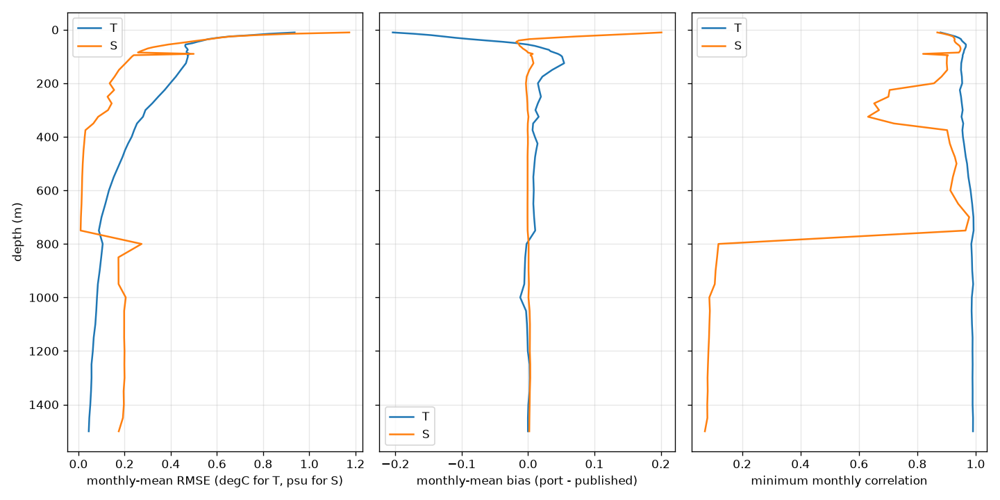

# Reproduction of the published AOTD monthly climatology (faithful MATLAB port)

Compares `aotd/upstream_port.py` output with the published monthly climatology, per level, over all valid cells
in both products. Source: `reports/reproduction/level_stats.csv` (12 months x T/S x levels).
Levels covered: 2-56 (55 levels; level 0 and any level missing from the CSV were not scored).

## Summary
- **Temperature**: RMSE median 0.280 degC, worst 0.937 degC at level 2 (10 m); minimum monthly correlation 0.879; levels with valid-cell count mismatch: 0 of 55 (largest mismatch 0 cells).
- **Salinity**: RMSE median 0.198 psu, worst 1.173 psu at level 2 (10 m); minimum monthly correlation 0.072; levels with valid-cell count mismatch: 33 of 55 (largest mismatch 702 cells).

Conclusion: the port reproduces the published fields closely (valid-cell counts match exactly for T) but not
bit-for-bit. The residual is largest in the upper ocean. Known candidate causes are a different data/QC
version and the missing bathymetry file upstream (see `docs/upstream_bug_log.md`, `STATUS.md`).

Columns: rmse = mean over months; rmse_max_month = worst month; maxabs = largest absolute difference;
corr = minimum over months; count_diff = largest |n_port - n_pub| valid cells.

## Temperature, per level

|   level |   depth_m |   rmse |   rmse_max_month |   bias |   maxabs |   corr |   count_diff |
|--------:|----------:|-------:|-----------------:|-------:|---------:|-------:|-------------:|
|       2 |        10 |  0.937 |            1.313 | -0.204 |   12.286 |  0.879 |            0 |
|       3 |        15 |  0.825 |            1.163 | -0.172 |    9.745 |  0.897 |            0 |
|       4 |        20 |  0.748 |            1.048 | -0.146 |    8.239 |  0.914 |            0 |
|       5 |        25 |  0.654 |            0.946 | -0.128 |    8.279 |  0.931 |            0 |
|       6 |        30 |  0.602 |            0.847 | -0.109 |    7.26  |  0.942 |            0 |
|       7 |        35 |  0.562 |            0.771 | -0.087 |    7     |  0.949 |            0 |
|       8 |        40 |  0.539 |            0.724 | -0.063 |    7.144 |  0.952 |            0 |
|       9 |        45 |  0.515 |            0.708 | -0.038 |    7.423 |  0.956 |            0 |
|      10 |        50 |  0.495 |            0.734 | -0.017 |    7.229 |  0.961 |            0 |
|      11 |        55 |  0.464 |            0.723 | -0.001 |    7.121 |  0.966 |            0 |
|      12 |        60 |  0.462 |            0.722 |  0.01  |    7.134 |  0.966 |            0 |
|      13 |        65 |  0.465 |            0.715 |  0.017 |    6.929 |  0.965 |            0 |
|      14 |        70 |  0.471 |            0.704 |  0.024 |    6.537 |  0.963 |            0 |
|      15 |        75 |  0.474 |            0.691 |  0.032 |    6.404 |  0.961 |            0 |
|      16 |        80 |  0.469 |            0.645 |  0.034 |    6.425 |  0.96  |            0 |
|      17 |        85 |  0.468 |            0.656 |  0.039 |    6.438 |  0.959 |            0 |
|      18 |        90 |  0.483 |            0.675 |  0.045 |    6.495 |  0.957 |            0 |
|      19 |        95 |  0.473 |            0.687 |  0.049 |    6.502 |  0.955 |            0 |
|      20 |       100 |  0.474 |            0.688 |  0.051 |    6.522 |  0.955 |            0 |
|      21 |       125 |  0.466 |            0.709 |  0.054 |    6.69  |  0.95  |            0 |
|      22 |       150 |  0.444 |            0.684 |  0.036 |    6.718 |  0.95  |            0 |
|      23 |       175 |  0.422 |            0.624 |  0.022 |    6.697 |  0.953 |            0 |
|      24 |       200 |  0.397 |            0.562 |  0.015 |    6.495 |  0.954 |            0 |
|      25 |       225 |  0.373 |            0.566 |  0.017 |    6.005 |  0.946 |            0 |
|      26 |       250 |  0.346 |            0.512 |  0.019 |    6.094 |  0.95  |            0 |
|      27 |       275 |  0.32  |            0.482 |  0.015 |    5.779 |  0.952 |            0 |
|      28 |       300 |  0.29  |            0.467 |  0.011 |    5.336 |  0.955 |            0 |
|      29 |       325 |  0.28  |            0.464 |  0.016 |    6.078 |  0.951 |            0 |
|      30 |       350 |  0.254 |            0.419 |  0.008 |    5.074 |  0.957 |            0 |
|      31 |       375 |  0.241 |            0.42  |  0.007 |    4.874 |  0.954 |            0 |
|      32 |       400 |  0.231 |            0.398 |  0.01  |    4.946 |  0.956 |            0 |
|      33 |       425 |  0.215 |            0.373 |  0.014 |    5.014 |  0.96  |            0 |
|      34 |       450 |  0.202 |            0.35  |  0.012 |    5.025 |  0.963 |            0 |
|      35 |       475 |  0.191 |            0.328 |  0.011 |    4.991 |  0.966 |            0 |
|      36 |       500 |  0.178 |            0.299 |  0.01  |    4.934 |  0.97  |            0 |
|      37 |       550 |  0.153 |            0.265 |  0.008 |    5.084 |  0.975 |            0 |
|      38 |       600 |  0.132 |            0.214 |  0.009 |    3.92  |  0.982 |            0 |
|      39 |       650 |  0.117 |            0.172 |  0.008 |    3.543 |  0.988 |            0 |
|      40 |       700 |  0.1   |            0.135 |  0.009 |    3.531 |  0.992 |            0 |
|      41 |       750 |  0.088 |            0.127 |  0.011 |    3.354 |  0.993 |            0 |
|      42 |       800 |  0.105 |            0.176 | -0.002 |    3.277 |  0.985 |            0 |
|      43 |       850 |  0.099 |            0.16  | -0.004 |    3.235 |  0.987 |            0 |
|      44 |       900 |  0.092 |            0.148 | -0.005 |    3.111 |  0.988 |            0 |
|      45 |       950 |  0.084 |            0.124 | -0.006 |    4.713 |  0.991 |            0 |
|      46 |      1000 |  0.08  |            0.15  | -0.012 |    4.249 |  0.987 |            0 |
|      47 |      1050 |  0.077 |            0.153 | -0.003 |    3.969 |  0.986 |            0 |
|      48 |      1100 |  0.073 |            0.141 | -0.002 |    5.674 |  0.987 |            0 |
|      49 |      1150 |  0.066 |            0.122 | -0.001 |    5.184 |  0.989 |            0 |
|      50 |      1200 |  0.062 |            0.12  | -0     |    3.531 |  0.989 |            0 |
|      51 |      1250 |  0.057 |            0.116 |  0.002 |    3.576 |  0.989 |            0 |
|      52 |      1300 |  0.057 |            0.117 |  0.003 |    3.983 |  0.989 |            0 |
|      53 |      1350 |  0.055 |            0.113 |  0.002 |    3.882 |  0.989 |            0 |
|      54 |      1400 |  0.051 |            0.113 |  0     |    3.732 |  0.989 |            0 |
|      55 |      1450 |  0.047 |            0.103 | -0     |    3.566 |  0.991 |            0 |
|      56 |      1500 |  0.045 |            0.104 | -0     |    3.585 |  0.991 |            0 |

## Salinity, per level

|   level |   depth_m |   rmse |   rmse_max_month |   bias |   maxabs |   corr |   count_diff |
|--------:|----------:|-------:|-----------------:|-------:|---------:|-------:|-------------:|
|       2 |        10 |  1.173 |            1.566 |  0.201 |   31.803 |  0.868 |          702 |
|       3 |        15 |  0.919 |            1.272 |  0.16  |   32.111 |  0.891 |           89 |
|       4 |        20 |  0.771 |            1.073 |  0.117 |   30.679 |  0.909 |          384 |
|       5 |        25 |  0.659 |            0.943 |  0.073 |    9.721 |  0.922 |           56 |
|       6 |        30 |  0.608 |            0.87  |  0.036 |    9.606 |  0.925 |           53 |
|       7 |        35 |  0.568 |            0.805 |  0.002 |    9.411 |  0.928 |           49 |
|       8 |        40 |  0.522 |            0.769 | -0.014 |    8.931 |  0.927 |           40 |
|       9 |        45 |  0.478 |            0.721 | -0.018 |    8.794 |  0.929 |           38 |
|      10 |        50 |  0.436 |            0.664 | -0.015 |    8.806 |  0.933 |           37 |
|      11 |        55 |  0.39  |            0.598 | -0.014 |    8.747 |  0.939 |           31 |
|      12 |        60 |  0.356 |            0.534 | -0.013 |    8.723 |  0.944 |           28 |
|      13 |        65 |  0.324 |            0.494 | -0.01  |    6.32  |  0.947 |           27 |
|      14 |        70 |  0.3   |            0.466 | -0.008 |    6.26  |  0.948 |           23 |
|      15 |        75 |  0.285 |            0.444 | -0.005 |    6.128 |  0.948 |           20 |
|      16 |        80 |  0.269 |            0.427 | -0.002 |    6.057 |  0.946 |           15 |
|      17 |        85 |  0.258 |            0.414 | -0     |    6.003 |  0.942 |           11 |
|      18 |        90 |  0.499 |            0.656 |  0.007 |   29.166 |  0.82  |            0 |
|      19 |        95 |  0.239 |            0.391 |  0.004 |    5.936 |  0.905 |            0 |
|      20 |       100 |  0.232 |            0.384 |  0.006 |    5.929 |  0.901 |            0 |
|      21 |       125 |  0.204 |            0.329 |  0.008 |    5.658 |  0.901 |            0 |
|      22 |       150 |  0.175 |            0.278 |  0.002 |    5.555 |  0.902 |            0 |
|      23 |       175 |  0.157 |            0.258 | -0.002 |    5.673 |  0.883 |            0 |
|      24 |       200 |  0.135 |            0.237 | -0.003 |    5.697 |  0.857 |            0 |
|      25 |       225 |  0.155 |            0.299 | -0.003 |   32.381 |  0.705 |            0 |
|      26 |       250 |  0.126 |            0.24  | -0.002 |   32.423 |  0.701 |            0 |
|      27 |       275 |  0.144 |            0.224 | -0.001 |   34.187 |  0.652 |            1 |
|      28 |       300 |  0.128 |            0.185 | -0.001 |   34.249 |  0.669 |            1 |
|      29 |       325 |  0.085 |            0.182 |  0.001 |   34.064 |  0.631 |            0 |
|      30 |       350 |  0.065 |            0.13  | -0     |   33.613 |  0.72  |            0 |
|      31 |       375 |  0.03  |            0.058 | -0.001 |    1.458 |  0.902 |            0 |
|      32 |       400 |  0.027 |            0.052 | -0     |    1.466 |  0.907 |            0 |
|      33 |       425 |  0.025 |            0.047 | -0     |    1.472 |  0.911 |            0 |
|      34 |       450 |  0.022 |            0.042 | -0.001 |    1.073 |  0.919 |            0 |
|      35 |       475 |  0.02  |            0.038 | -0.001 |    0.757 |  0.928 |            0 |
|      36 |       500 |  0.019 |            0.035 | -0.001 |    0.74  |  0.934 |            0 |
|      37 |       550 |  0.016 |            0.035 | -0.001 |    0.589 |  0.922 |            0 |
|      38 |       600 |  0.015 |            0.035 | -0.001 |    0.614 |  0.913 |            0 |
|      39 |       650 |  0.013 |            0.027 | -0.001 |    0.63  |  0.94  |            0 |
|      40 |       700 |  0.011 |            0.015 | -0.001 |    0.595 |  0.978 |            0 |
|      41 |       750 |  0.009 |            0.018 | -0.001 |    0.457 |  0.965 |            0 |
|      42 |       800 |  0.274 |            0.501 |  0.001 |   34.865 |  0.119 |            8 |
|      43 |       850 |  0.173 |            0.502 |  0.001 |   34.87  |  0.114 |            8 |
|      44 |       900 |  0.174 |            0.504 |  0.001 |   34.874 |  0.109 |            8 |
|      45 |       950 |  0.174 |            0.505 |  0.001 |   34.875 |  0.106 |            8 |
|      46 |      1000 |  0.205 |            0.619 |  0.001 |   34.879 |  0.088 |           13 |
|      47 |      1050 |  0.198 |            0.591 |  0.002 |   34.882 |  0.09  |           13 |
|      48 |      1100 |  0.198 |            0.593 |  0.003 |   34.886 |  0.088 |           13 |
|      49 |      1150 |  0.198 |            0.595 |  0.003 |   34.888 |  0.087 |           13 |
|      50 |      1200 |  0.2   |            0.598 |  0.003 |   34.891 |  0.085 |           13 |
|      51 |      1250 |  0.199 |            0.601 |  0.003 |   34.893 |  0.083 |           13 |
|      52 |      1300 |  0.2   |            0.603 |  0.003 |   34.897 |  0.082 |           13 |
|      53 |      1350 |  0.196 |            0.59  |  0.003 |   34.899 |  0.082 |           12 |
|      54 |      1400 |  0.197 |            0.593 |  0.002 |   34.902 |  0.081 |           12 |
|      55 |      1450 |  0.193 |            0.58  |  0.002 |   34.906 |  0.081 |           11 |
|      56 |      1500 |  0.175 |            0.637 |  0.002 |   34.91  |  0.072 |           20 |

## Diagnosis (added after review)

The per-level statistics above average over all 12 months and hide the main result:

- **March and September are reproduced essentially exactly.** At level 20, port vs published RMSE is 0.01 degC (T, March) / 0.08 degC (T, September) and 0.00-0.01 psu (S). The monthly correction fields (month minus seasonal) correlate 1.00 with the published ones.
- **The other ten months are not reproduced.** The published correction relative to the seasonal field is about 0.15 degC (0.05 psu) RMS, against 0.3-0.7 degC (0.17-0.38 psu) in the port, and the two are uncorrelated.
- Published S at 1500 m shows damped values near 0 psu (the BUG-19 `+1` damping) at cells where the port, in some months, has real data (34.9 psu). The published files keep the damped value in every month except September at those cells.
- This is not a month-label shift: correlating the published January and June corrections with corrections built from each of the 12 months' observations gives at most r = 0.37.
- Every month has 18k-32k valid observations at level 20, so sparse data does not explain it.

Conclusion: the port is faithful (it matches the months that carry the full monthly signal), and the discrepancy is in the published product for ten of the twelve months. Logged as BUG-29 in `docs/upstream_bug_log.md`; to be confirmed with the author. Scope for the new product: validate against March and September only; do not treat the other published months as ground truth.

## Maps (`reports/reproduction/maps/`)
Generated by `scripts/repro_maps.py`. Polar maps of published, port, and port minus published.

- `cmp_{T,S}_L{level}_{depth}m.png`: Jan, Mar, Jun, Sep at 10, 100, 700 and 1500 m (columns: published, port, difference).
- `diff_all_months_{T,S}_L{level}_{depth}m.png`: difference for all 12 months at 10, 100 and 1500 m.
- `diff_depth_{T,S}_{Jan,Mar,Jun,Sep}.png`: difference at 7 depths for one month.

What the maps show:
1. **March and September**: difference is essentially zero everywhere (T 100 m: below 0.01 and 0.08 degC). Only small isolated spots remain (a few cells around isolated observations, mostly in the Nordic and Barents seas).
2. **Other months**: the published fields are smooth, while the port shows the blocky, polygon-shaped patches expected from the released algorithm (BUG-19/20: a single distant observation sets a whole region). Published March and September show the same blocks as the port, so the other ten published months were generated by a different, smoother procedure.
3. **Where the differences are**: largest on the Atlantic side (Barents, Fram Strait, Nordic seas) and the Siberian shelves/slope, where the port patches differ most from the smooth published fields. The central Canada Basin differences are small.
4. **With depth**: at 1200-1500 m, published January and June salinity and temperature look like the seasonal first guess (visually like published March), while the port has wedge-shaped patches where sparse monthly observations exist. This is consistent with the published months ignoring monthly data when few observations are in range (as the `numel(tt)>=10` rule in the unused `Barnes()` suggests), but the 100 m grid search did not confirm it (BUG-29; best correlation 0.55). Next test: apply the minimum-count rule on the observation count within the radius at 1500 m, where the effect is clearest.
