# AOTD scattered (profile) data: descriptive report

*Generated 2026-10-14 by `scripts/07_scatter_data_report.py`. All numbers are computed from `data/scatter_all.npz` (the normalised cache of the yearly files; NaN = missing for T, S, pressure and density).*

## Executive summary

* **Size.** 414,221 profiles, 1983-2023; 414,221 with T, 414,220 with S, 414,220 with both (0.00% of profiles with T have no S). Median 25 valid levels; median maximum depth 250 m.
* **Depth.** Fraction reaching >=700 m: 34.9%; >=1500 m: 9.6%; >=3000 m: 0.7%. The 0 m level is empty; 5 m is 67% filled, 10 m 90%.
* **Time.** 81.3% of the profiles are from 2005 onwards; peak year 2019 (30,992). Jun-Sep holds 36.1% of profiles, Dec-Mar 28.6%.
* **Space.** 11.0% of the 17.3 million km2 of 60-90N ocean (EASE2 100 km boxes) has no profile; 72.2% has >=10; 40.1% has data from >=10 distinct years.
* **Inferred provenance (INFERRED, not ground truth).** ITP-like 120,157 (29.0%); Argo-like 23,262 (5.6%); ship-CTD-like 214,400 (51.8%); other/unclassified 56,402 (13.6%).
* **Duplicates.** 437,714 pairs still within 0.1 deg / 6 h (62,271 pairs within 1 km / 1 h); 2,057 redundant exact copies with >=5 valid levels.
* **Quality.** 5.0% of profiles have a static inversion >0.01 kg/m3; 27,978 profiles have a T step >0.3 degC/m; 1.03% of T values are within 0.01 degC of freezing.
* **Fitness (by rule, Section 8).** Gridded climatology 0-1500 m: Marginal; Regional climatology of the Atlantic layer: Marginal; Basin-scale deep: Poor; Mixed layer / near-surface: Marginal; Halocline structure: Good; Interannual variability / trends: Marginal; Seasonal cycle in the central Arctic: Good; Eulerian time series at a point: Marginal; Validation of models/reanalyses: Marginal; Ocean heat content 0-700 m: Marginal.

## Data notes and conventions

* Missing values: the raw yearly files encode missing S and pressure as 0.0 and density arbitrarily; the loader/cache normalises these to NaN and this report uses only the normalised arrays.
* T and S are always valid together (11,811,887 valid T/S level-values). The 0 m level has no T or S in any profile.
* There is no platform/source field in the files. Anything labelled *INFERRED* is a heuristic guess from sampling patterns and is not ground truth.
* Boxes: 100 km x 100 km blocks of the EASE-Grid 2.0 North grid (EPSG:6931); land from the EASE2 land mask.
* Regions are simple longitude/latitude polygons defined in the script (Section 5).

## 1. Overview of the profile data

The scatter files hold **414,221** profiles from 1983 to 2023, each on the 102 WOA standard depths (0-5500 m). Counts below refer to a profile as having a *valid T* if at least one level is non-NaN.

| quantity | value | share |
|---|---|---|
| Profiles in total | 414,221 | 100% |
| Profiles with valid T | 414,221 | 100.0% |
| Profiles with valid S | 414,220 | 100.0% |
| Profiles with both T and S | 414,220 | 100.0% |
| T valid but S entirely missing | 1 | 0.0% of profiles with T |
| S valid but T entirely missing | 0 | 0.0% |
| Profiles with a single valid T level | 23,151 | 5.6% of profiles with T |
| Profiles with 1-3 valid T levels | 35,965 | 8.7% of profiles with T |
| Profiles with internal gaps (missing levels between first and last valid) | 0 | 0.0% |
| T cells valid (of N x 102) | 11,811,887 | 28.0% |
| S cells valid | 11,811,886 | 28.0% |
| T valid where S missing (cells) | 1 | 0.0% of T cells |
| S valid where T missing (cells) | 0 | 0.0% of S cells |
| Median number of valid T levels per profile | 25 |  |
| Median maximum valid depth (m) | 250 |  |

**Levels with valid T per profile**

| levels with valid T | profiles | fraction (%) | cumulative (%) |
|---|---|---|---|
| 0 | 0 | 0.00 | 0.00 |
| 1 | 23,151 | 5.59 | 5.59 |
| 2-5 | 26,047 | 6.29 | 11.88 |
| 6-10 | 38,537 | 9.30 | 21.18 |
| 11-20 | 51,326 | 12.39 | 33.57 |
| 21-40 | 176,623 | 42.64 | 76.21 |
| 41-57 | 61,456 | 14.84 | 91.05 |
| 58-80 | 36,043 | 8.70 | 99.75 |
| 81-102 | 1,038 | 0.25 | 100.00 |

**Maximum valid depth** (deepest non-NaN T level; S analogous)

| max valid depth >= (m) | profiles with T (N) | fraction of profiles with T (%) | profiles with S (N) | fraction of profiles with S (%) |
|---|---|---|---|---|
| 0.00 | 414,221.00 | 100.00 | 414,220.00 | 100.00 |
| 10.00 | 408,299.00 | 98.57 | 408,299.00 | 98.57 |
| 50.00 | 337,539.00 | 81.49 | 337,539.00 | 81.49 |
| 100.00 | 299,143.00 | 72.22 | 299,143.00 | 72.22 |
| 300.00 | 192,313.00 | 46.43 | 192,313.00 | 46.43 |
| 700.00 | 144,718.00 | 34.94 | 144,718.00 | 34.94 |
| 1,000.00 | 58,457.00 | 14.11 | 58,457.00 | 14.11 |
| 1,500.00 | 39,764.00 | 9.60 | 39,764.00 | 9.60 |
| 2,000.00 | 11,065.00 | 2.67 | 11,065.00 | 2.67 |
| 3,000.00 | 2,722.00 | 0.66 | 2,722.00 | 0.66 |
| 4,000.00 | 164.00 | 0.04 | 164.00 | 0.04 |
| 5,500.00 | 5.00 | 0.00 | 5.00 | 0.00 |

**Value ranges** (valid cells only)

| variable | unit | N values | min | p0.1 | p1 | median | mean | std | p99 | p99.9 | max |
|---|---|---|---|---|---|---|---|---|---|---|---|
| temp (in-situ T) | degC | 11,811,887 | -2.000 | -1.870 | -1.783 | 1.674 | 2.710 | 3.553 | 10.780 | 13.200 | 19.970 |
| salt (practical S) | - | 11,811,886 | 0.009 | 3.573 | 27.392 | 34.881 | 34.007 | 2.590 | 35.332 | 35.409 | 36.329 |
| dens (in-situ density) | kg m-3 | 11,811,886 | 998.892 | 1,002.875 | 1,021.955 | 1,027.896 | 1,028.285 | 3.196 | 1,036.746 | 1,042.091 | 1,053.219 |
| pres | dbar | 11,811,887 | 0.010 | 5.048 | 5.051 | 90.968 | 294.416 | 434.150 | 1,927.721 | 3,054.409 | 5,631.375 |

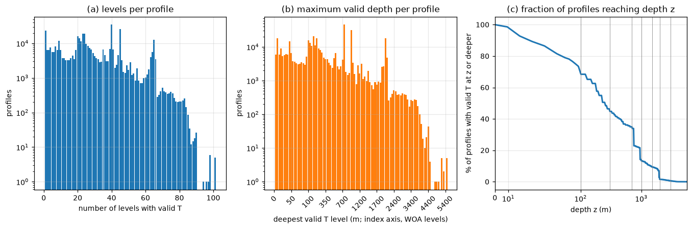

*Reading:* about 72% of all T cells are NaN because most profiles are shallow; only 14.1% of profiles with T reach 1000 m and 2.7% reach 2000 m. Profiles reaching 5500 m: 5.

## 2. Temporal distribution

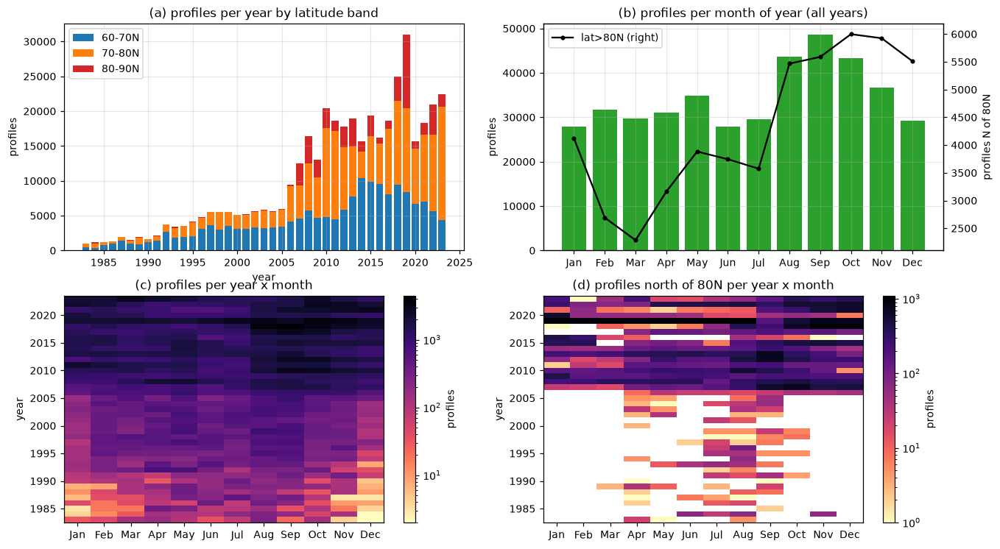

**Profiles per decade**

| decade | profiles | fraction (%) | profiles per year | median max depth (m) | % reaching 1000 m | % with S |
|---|---|---|---|---|---|---|
| 1983-1992 | 17,712 | 4.3 | 1,771 | 275 | 13.5 | 100.0 |
| 1993-2002 | 48,486 | 11.7 | 4,849 | 250 | 13.9 | 100.0 |
| 2003-2012 | 125,703 | 30.3 | 12,570 | 250 | 14.0 | 100.0 |
| 2013-2023 | 222,320 | 53.7 | 20,211 | 225 | 14.3 | 100.0 |

**Profiles per season** (month-of-year bins, all years)

| season | scheme | profiles | fraction (%) | profiles lat>80N | % of lat>80N total | profiles lat>70N |
|---|---|---|---|---|---|---|
| DJF | calendar (DJF..) | 88,792 | 21.4 | 12,322 | 23.7 | 53,972 |
| MAM | calendar (DJF..) | 95,729 | 23.1 | 9,332 | 18.0 | 45,333 |
| JJA | calendar (DJF..) | 101,012 | 24.4 | 12,788 | 24.6 | 59,440 |
| SON | calendar (DJF..) | 128,688 | 31.1 | 17,513 | 33.7 | 84,165 |
| JFM | WOA-style (JFM..) | 89,369 | 21.6 | 9,098 | 17.5 | 51,406 |
| AMJ | WOA-style (JFM..) | 93,822 | 22.7 | 10,791 | 20.8 | 43,966 |
| JAS | WOA-style (JFM..) | 121,791 | 29.4 | 14,632 | 28.2 | 79,333 |
| OND | WOA-style (JFM..) | 109,239 | 26.4 | 17,434 | 33.6 | 68,205 |

**Profiles per month of year**

| month | profiles | fraction (%) | profiles lat>80N | profiles lat>70N |
|---|---|---|---|---|
| Jan | 27,898 | 6.7 | 4,119 | 17,699 |
| Feb | 31,730 | 7.7 | 2,693 | 17,558 |
| Mar | 29,741 | 7.2 | 2,286 | 16,149 |
| Apr | 31,093 | 7.5 | 3,162 | 14,246 |
| May | 34,895 | 8.4 | 3,884 | 14,938 |
| Jun | 27,834 | 6.7 | 3,745 | 14,782 |
| Jul | 29,497 | 7.1 | 3,575 | 17,242 |
| Aug | 43,681 | 10.5 | 5,468 | 27,416 |
| Sep | 48,613 | 11.7 | 5,589 | 34,675 |
| Oct | 43,364 | 10.5 | 5,999 | 27,679 |
| Nov | 36,711 | 8.9 | 5,925 | 21,811 |
| Dec | 29,164 | 7.0 | 5,510 | 18,715 |

The full year table is `tables/s2_profiles_per_year.csv` and the year x month matrix is `tables/s2_profiles_year_x_month.csv`.

*Reading.* The record peaks in 2019 (30,992 profiles) and has its minimum in 1983 (1,027). Mean annual sampling is 3,530 profiles/yr for 1983-2004 and 17,714 profiles/yr for 2005-2023 (x5.0); 81.3% of all profiles are from 2005 onward. The seasonal bias is strong: 29.4% of profiles fall in Jul-Sep against 21.6% in Jan-Mar; north of 80N the ratio is 28.2% vs 17.5% (the most-sampled month is Sep, the least-sampled Jun, ratio 1.7). The summer maximum is consistent with ship access to ice-covered water (see section 6 for the inferred platform types).

## 3. Spatial distribution

Profiles were binned on a 100 km x 100 km grid that is an exact 4x4 block aggregation of the NSIDC EASE-Grid 2.0 North 25 km grid (EPSG:6931, Lambert azimuthal equal area, so every box has the same area; 180x180 boxes cover the hemisphere, all profiles are north of 60N). Ocean area is taken from the EASE2 25 km land mask (`EASE2_N25km.LOCImask_land50_coast0km`, value 255 = water in the file, as verified against its PNG legend and profile positions; 625 km2 per cell, cells north of 60N): 17.30 million km2 in 2,148 boxes containing any ocean. This includes marginal seas such as Hudson Bay, the Baltic, Gulf of Alaska and the parts of the Sea of Okhotsk north of 60N, so the 'ocean without data' fraction counts every one of them. 49 occupied boxes contain no ocean cell of that mask (coastal/land boxes).

### 3a. Counts per 100 km box

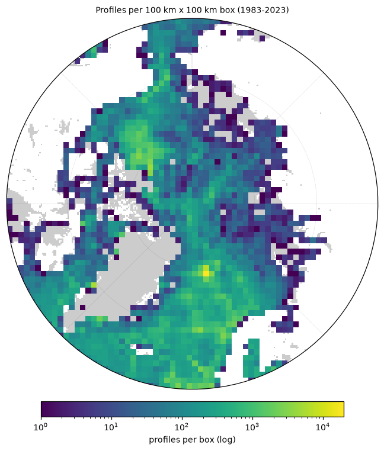

**Distribution of box counts, and by decade and season** (`tables/s3_box_count_distribution*.csv`)

| slice | boxes >=1 | boxes >=5 | boxes >=10 | boxes >=50 | boxes >=100 | boxes >=1000 | median per occupied | mean per occupied | max | % ocean area with 0 profiles | % ocean area with >=10 |
|---|---|---|---|---|---|---|---|---|---|---|---|
| all | 1,806 | 1,554 | 1,398 | 1,008 | 789 | 83 | 69.0 | 229.4 | 19,811 | 11.0 | 72.2 |
| decade 1983-1992 | 852 | 560 | 399 | 86 | 30 | 0 | 8.0 | 20.8 | 491 | 57.0 | 20.8 |
| decade 1993-2002 | 1,146 | 776 | 583 | 233 | 133 | 0 | 10.0 | 42.3 | 933 | 41.8 | 30.3 |
| decade 2003-2012 | 1,372 | 1,127 | 988 | 557 | 301 | 8 | 35.0 | 91.6 | 14,465 | 28.9 | 52.7 |
| decade 2013-2023 | 1,382 | 1,187 | 1,090 | 733 | 529 | 34 | 57.0 | 160.9 | 5,485 | 30.1 | 56.3 |
| season JFM | 986 | 822 | 729 | 394 | 217 | 7 | 36.0 | 90.6 | 4,499 | 50.2 | 37.7 |
| season AMJ | 1,030 | 825 | 726 | 450 | 254 | 8 | 36.0 | 91.1 | 2,270 | 47.9 | 37.6 |
| season JAS | 1,654 | 1,339 | 1,150 | 604 | 328 | 7 | 28.0 | 73.6 | 6,415 | 16.9 | 60.3 |
| season OND | 1,295 | 1,071 | 946 | 493 | 264 | 7 | 33.0 | 84.4 | 6,627 | 33.5 | 49.2 |
| season DJF | 1,011 | 854 | 767 | 419 | 225 | 6 | 38.0 | 87.8 | 4,889 | 48.3 | 39.8 |
| season MAM | 970 | 783 | 690 | 432 | 240 | 10 | 36.5 | 98.7 | 3,373 | 51.2 | 35.5 |
| season JJA | 1,523 | 1,165 | 993 | 539 | 266 | 8 | 23.0 | 66.3 | 3,809 | 23.1 | 51.9 |
| season SON | 1,561 | 1,283 | 1,133 | 599 | 304 | 12 | 32.0 | 82.4 | 7,740 | 21.1 | 59.6 |

*Reading.* 1,806 boxes hold at least one profile; the median occupied box has 69 profiles, the mean 229, the maximum 19,811 (heavy-tailed: a few boxes with ice-drift stations or repeated sections dominate). 11.0% of the 60-90N ocean area lies in boxes with no profile at all, and only 72.2% lies in boxes with >=10 profiles over the whole 41 years. The densest boxes (centre lat, lon, count): (78.6N, 11.3E, 19,811); (79.4N, 12.3E, 6,827); (69.5N, -50.4E, 5,509); (81.1N, -130.9E, 4,643); (81.7N, -126.3E, 3,424).

### 3b. By decade

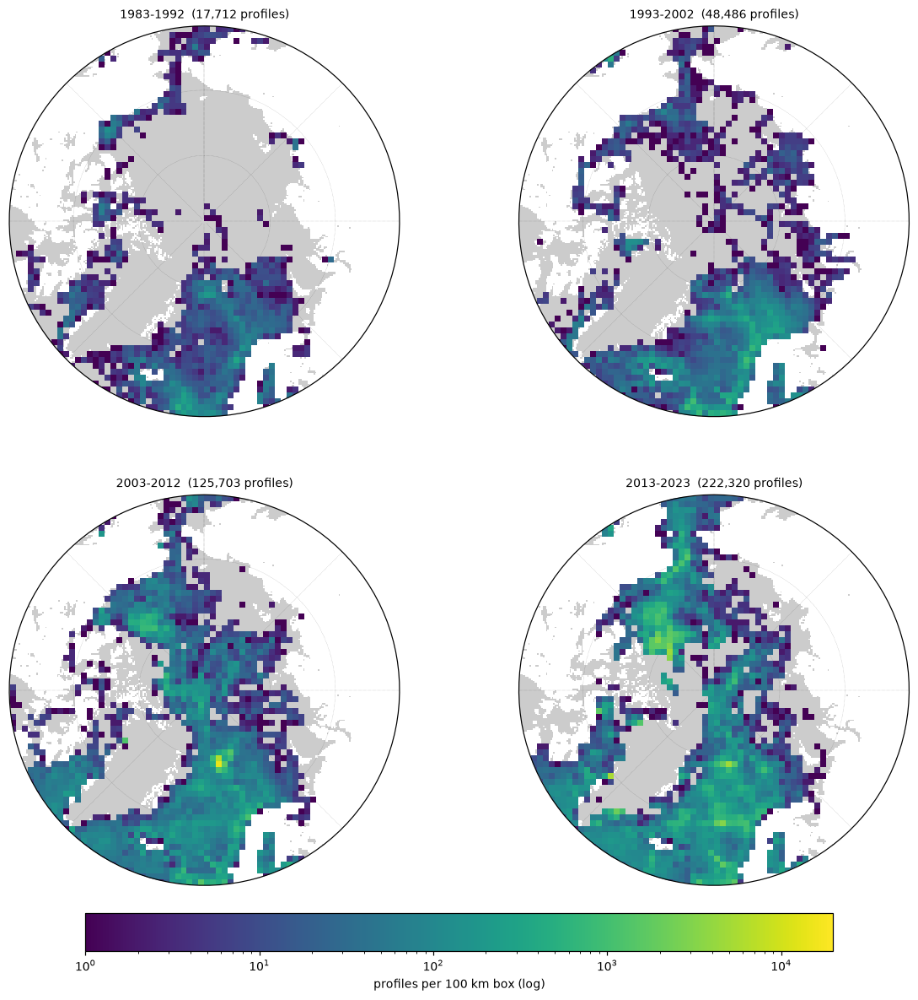

### 3c. By season (WOA-style quarters)

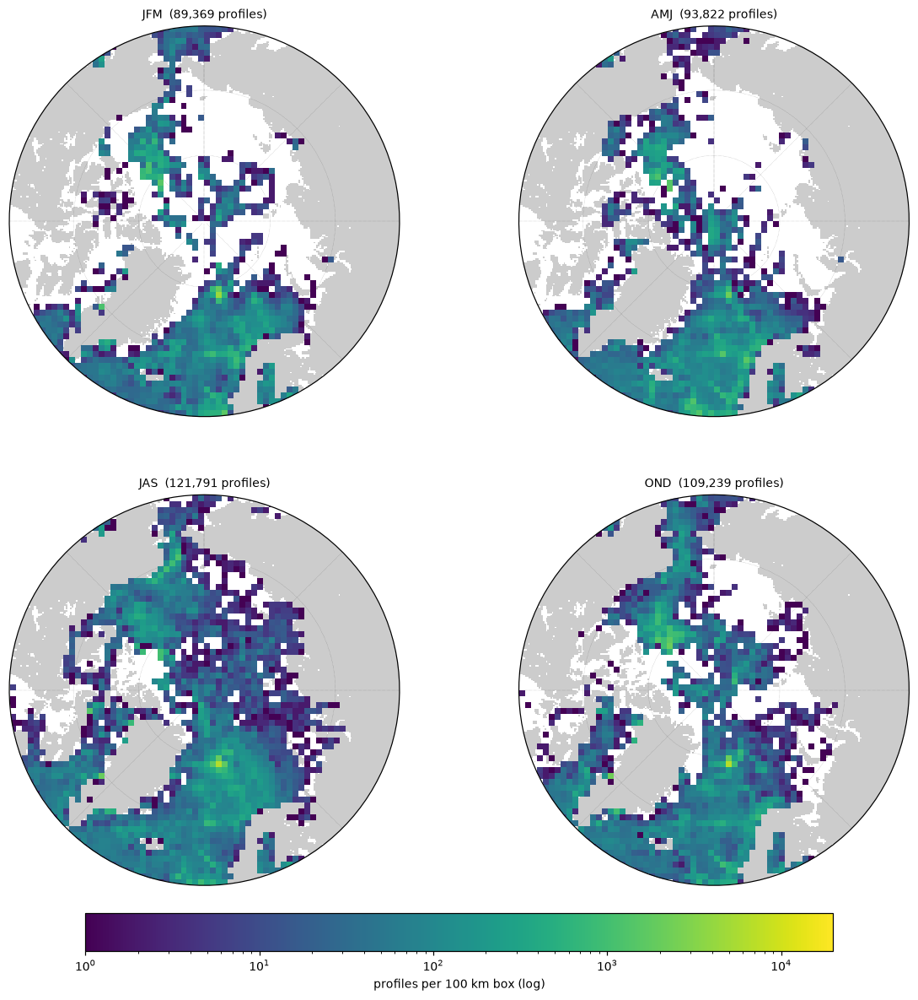

### 3d. Temporal diversity of each box

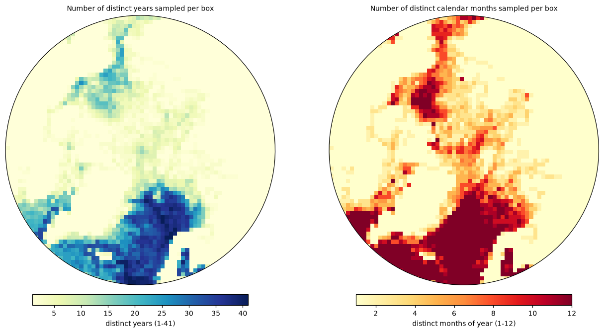

Boxes sampled in >=10 distinct years: 770; in >=20 years: 501; in all 12 calendar months: 409; in >=6 calendar months: 862. Ocean-area fraction with data in >=10 distinct years: 40.1%; in >=6 calendar months: 44.9%.

### 3e. Lat/lon grids

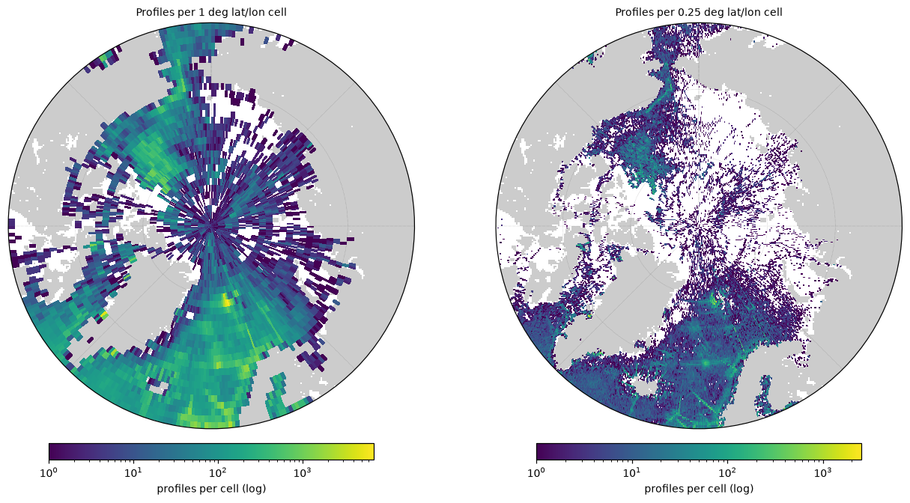

| grid | cells with data | cells >=5 | cells >=10 | cells >=50 | cells >=100 | cells >=1000 | median per occupied | mean per occupied | max | ocean cells in grid (WOA23 0.25 deg mask) | % ocean cells with data |
|---|---|---|---|---|---|---|---|---|---|---|---|
| 1 deg lat/lon | 5,911 | 4,022 | 3,142 | 1,581 | 1,069 | 37 | 11.0 | 70.1 | 6,968 | 7,519 | 78.6 |
| 0.25 deg lat/lon | 42,405 | 17,815 | 9,502 | 1,250 | 494 | 6 | 3.0 | 9.8 | 2,521 | 108,927 | 38.9 |

On the 1 deg grid 78.6% of WOA23 ocean cells north of 60N contain a profile (41.8% contain >=10); on the 0.25 deg grid 38.9% (8.7% with >=10). Cell lists: `tables/s3_grid_1deg_counts.csv`, `tables/s3_grid_0.25deg_counts.csv`; 100 km box list: `tables/s3_box100km_counts.csv` (columns x, y [EPSG:6931 metres], lon, lat, count, n_years, n_months, n_year_months, ocean_area_km2).

## 4. Depth distribution

Number of valid observations at each of the 102 standard levels (full table `tables/s4_observations_per_level.csv`, which also has the per-decade counts and the box coverage at every level).

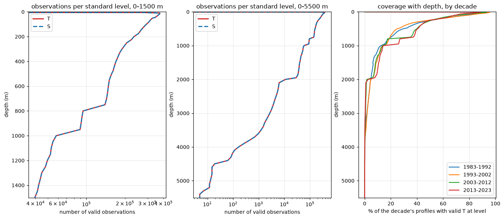

**Observations by depth range**

| range | levels | T obs | S obs | profiles with any T | % of all profiles |
|---|---|---|---|---|---|
| 0-1500 m (WOA monthly & seasonal, 57 levels) | 57 | 11,428,386 | 11,428,385 | 413,951 | 99.9 |
| 1500-5500 m (levels deeper than 1500 m; WOA annual only) | 45 | 383,501 | 383,501 | 38,865 | 9.4 |
| 0-5500 m (WOA annual, 102 levels) | 102 | 11,811,887 | 11,811,886 | 414,221 | 100.0 |

There are 11,428,386 T observations in 0-1500 m but only 383,501 below 1500 m (3.25% of all T observations) from 38,865 profiles.

**Horizontal coverage at selected depths** (T; boxes of 100 km; ocean area from the EASE2 mask)

| depth (m) | T obs | % of profiles | boxes >=1 | boxes >=10 | ocean area % >=1 | ocean area % >=10 |
|---|---|---|---|---|---|---|
| 0.0 | 0.0 | 0.0 | 0.0 | 0.0 | 0.0 | 0.0 |
| 100.0 | 293,894.0 | 71.0 | 1,473.0 | 1,177.0 | 75.4 | 62.3 |
| 500.0 | 157,300.0 | 38.0 | 981.0 | 794.0 | 53.3 | 44.2 |
| 1,000.0 | 58,010.0 | 14.0 | 708.0 | 418.0 | 39.3 | 23.3 |
| 2,000.0 | 11,022.0 | 2.7 | 501.0 | 225.0 | 28.0 | 12.8 |
| 3,000.0 | 2,699.0 | 0.7 | 291.0 | 60.0 | 16.5 | 3.5 |
| 5,000.0 | 13.0 | 0.0 | 4.0 | 0.0 | 0.2 | 0.0 |

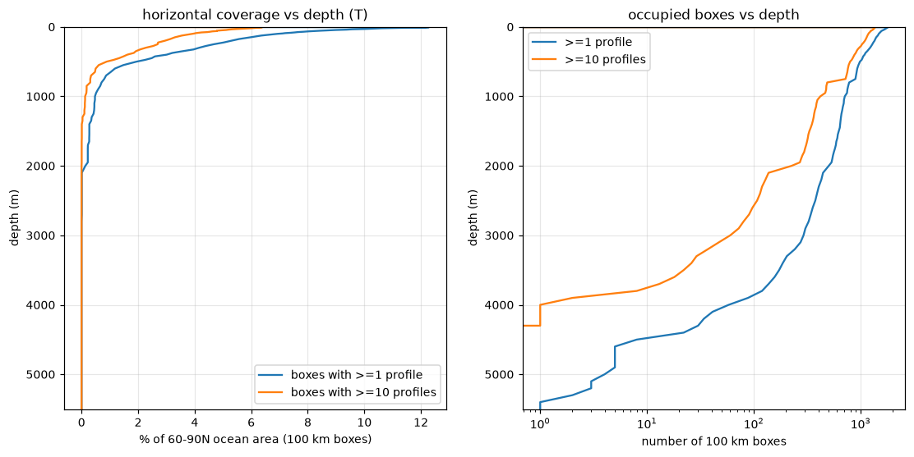

**Profiles with valid T per level and decade** (selected levels; all levels in the CSV)

| depth_m | T_obs_1983-1992 | T_obs_1993-2002 | T_obs_2003-2012 | T_obs_2013-2023 |
|---|---|---|---|---|
| 0 | 0 | 0 | 0 | 0 |
| 20 | 15,711 | 46,026 | 116,166 | 193,357 |
| 50 | 15,167 | 43,372 | 103,142 | 168,613 |
| 100 | 13,502 | 38,395 | 88,987 | 153,010 |
| 200 | 10,383 | 28,374 | 70,404 | 125,955 |
| 300 | 7,836 | 19,451 | 59,567 | 103,012 |
| 500 | 5,229 | 12,024 | 50,145 | 89,902 |
| 700 | 3,838 | 9,683 | 45,661 | 84,619 |
| 1,000 | 2,187 | 6,644 | 17,513 | 31,666 |
| 1,500 | 1,103 | 4,247 | 10,431 | 23,713 |
| 2,000 | 815 | 2,307 | 1,989 | 5,911 |
| 3,000 | 289 | 898 | 714 | 798 |
| 4,000 | 16 | 25 | 65 | 58 |
| 5,500 | 1 | 0 | 3 | 1 |

**Maps of counts at selected depths**

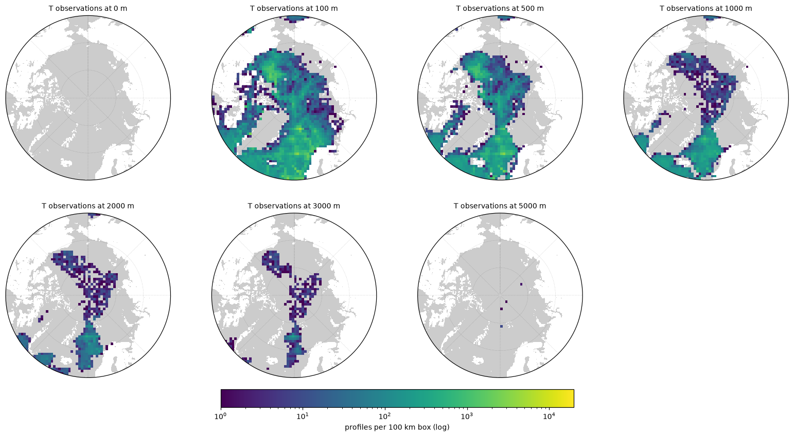

### Surface-level artefact and T/S consistency (computed)

The 0 m level contains **0** valid T values and 0 valid S values (100.0% empty). The 5 m level is 67.0% filled and the 10 m level 90.3% (15 m: 90.3%). The lower fill at 5 m is consistent with the upstream interpolation blanking the level nearest the first observation; near-surface (0-10 m) statistics must therefore be read as 5/10 m values. T and S are valid together in 11,811,886 level-values; cells where exactly one of them is valid: 1. Missing values are NaN after `scatter_io.load_scatter` / `data/scatter_all.npz` normalisation (raw yearly files use 0.0 for missing S/pres and arbitrary numbers for dens, so they are never read directly here).

## 5. Regional distribution

Regions are simple lon/lat boxes/polygons (applied in priority order, first match wins) defined in this script; they are approximations meant for bookkeeping, not oceanographic boundaries.

| region | definition (lon E, lat N) |
|---|---|
| Canadian Arctic Archipelago | polygon (-128,70) (-120,68.5) (-100,67) (-82,67.5) (-80,73.5) (-72,76) (-66,78) (-60,81) (-62,83) (-85,83) (-105,80) (-120,77) (-126,74) [lon E, lat N] |
| Hudson Bay / Foxe Basin | lon -95..-76, lat 51..66 |
| Central Arctic (>80N: Nansen/Amundsen/Makarov) | lat >= 80 (anywhere not already in the CAA polygon) |
| Baffin Bay / Davis Strait | lon -80..-50, lat 64..80 |
| Fram Strait / Greenland Sea | lon -35..15, lat 72..80 |
| Iceland Sea | lon -40..-8, lat 64.5..72 |
| Norwegian Sea | lon -12..18, lat 62..72 |
| Barents Sea | lon 18..55, lat 66..80 plus lon 15..18, lat 72..80 |
| Kara Sea | lon 55..100, lat 66..80 |
| Laptev Sea | lon 100..140, lat 66..80 |
| East Siberian Sea | lon 140..175, lat 66..80 |
| Chukchi Sea | lon 175..180 and -180..-157, lat 66..73 |
| Beaufort Sea / Canada Basin | lon -157..-100, lat 68..80; lon 175..180 / -180..-157, lat 73..80 |
| Bering Sea / Bering Strait | lat < 66, lon >= 160 or <= -150 |
| Labrador Sea / subpolar N Atlantic | lat < 64.5, lon -75..-12; lat < 62, lon -12..12 |
| Other | everything else (Baltic/Scandinavian coast, Okhotsk side, unassigned strips) |

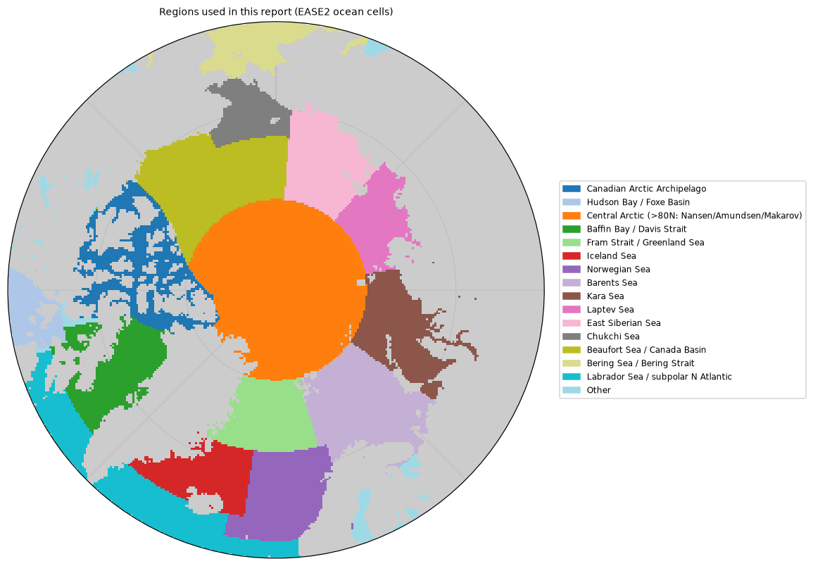

**Profiles per region and decade; median maximum depth; coverage of the region's ocean area by 100 km boxes**

| region | profiles | % of profiles | 1983-1992 | 1993-2002 | 2003-2012 | 2013-2023 | median max depth (m) | % reaching 1000 m | % with S | ocean area (1e6 km2) | % area in boxes >=1 | % area in boxes >=10 |
|---|---|---|---|---|---|---|---|---|---|---|---|---|
| Canadian Arctic Archipelago | 5,337 | 1.3 | 388 | 1,026 | 1,065 | 2,858 | 200 | 0.0 | 100.0 | 1.01 | 70.4 | 39.0 |
| Hudson Bay / Foxe Basin | 76 | 0.0 | 21 | 1 | 54 | 0 | 125 | 0.0 | 100.0 | 0.41 | 43.6 | 0.0 |
| Central Arctic (>80N: Nansen/Amundsen/Makarov) | 51,908 | 12.5 | 492 | 631 | 17,452 | 33,333 | 500 | 3.2 | 100.0 | 3.50 | 94.1 | 81.6 |
| Baffin Bay / Davis Strait | 16,464 | 4.0 | 635 | 381 | 3,745 | 11,703 | 150 | 1.7 | 100.0 | 0.91 | 81.6 | 75.4 |
| Fram Strait / Greenland Sea | 61,175 | 14.8 | 1,706 | 4,430 | 31,771 | 23,268 | 150 | 21.7 | 100.0 | 0.88 | 96.9 | 93.7 |
| Iceland Sea | 25,964 | 6.3 | 1,118 | 3,677 | 5,822 | 15,347 | 462 | 20.8 | 100.0 | 0.75 | 98.6 | 96.5 |
| Norwegian Sea | 66,517 | 16.1 | 4,462 | 12,126 | 15,773 | 34,156 | 950 | 28.7 | 100.0 | 1.07 | 100.0 | 100.0 |
| Barents Sea | 43,602 | 10.5 | 2,802 | 11,844 | 14,053 | 14,903 | 200 | 0.4 | 100.0 | 1.39 | 98.1 | 88.0 |
| Kara Sea | 777 | 0.2 | 97 | 318 | 256 | 106 | 75 | 0.0 | 100.0 | 1.01 | 80.6 | 26.1 |
| Laptev Sea | 1,081 | 0.3 | 105 | 467 | 277 | 232 | 90 | 24.9 | 99.9 | 0.69 | 94.0 | 48.5 |
| East Siberian Sea | 397 | 0.1 | 4 | 78 | 91 | 224 | 125 | 11.8 | 100.0 | 0.99 | 62.8 | 12.1 |
| Chukchi Sea | 11,346 | 2.7 | 175 | 385 | 731 | 10,055 | 35 | 0.2 | 100.0 | 0.54 | 88.7 | 73.7 |
| Beaufort Sea / Canada Basin | 57,741 | 13.9 | 735 | 911 | 13,448 | 42,647 | 250 | 1.9 | 100.0 | 1.67 | 96.0 | 91.3 |
| Bering Sea / Bering Strait | 4,976 | 1.2 | 289 | 184 | 733 | 3,770 | 30 | 4.2 | 100.0 | 0.64 | 96.0 | 83.5 |
| Labrador Sea / subpolar N Atlantic | 55,773 | 13.5 | 4,038 | 9,811 | 17,424 | 24,500 | 425 | 30.2 | 100.0 | 1.46 | 99.4 | 96.3 |
| Other | 11,087 | 2.7 | 645 | 2,216 | 3,008 | 5,218 | 45 | 0.0 | 100.0 | 0.38 | 57.3 | 37.3 |

**Median maximum depth (m) per region and decade**

| region | 1983-1992 | 1993-2002 | 2003-2012 | 2013-2023 |
|---|---|---|---|---|
| Canadian Arctic Archipelago | 150 | 225 | 225 | 200 |
| Hudson Bay / Foxe Basin | 275 | 100 | 125 | – |
| Central Arctic (>80N: Nansen/Amundsen/Makarov) | 475 | 500 | 750 | 225 |
| Baffin Bay / Davis Strait | 275 | 200 | 175 | 125 |
| Fram Strait / Greenland Sea | 500 | 1,150 | 80 | 950 |
| Iceland Sea | 425 | 350 | 450 | 550 |
| Norwegian Sea | 450 | 275 | 450 | 950 |
| Barents Sea | 225 | 225 | 150 | 200 |
| Kara Sea | 125 | 25 | 85 | 200 |
| Laptev Sea | 10 | 30 | 850 | 650 |
| East Siberian Sea | 12 | 28 | 250 | 200 |
| Chukchi Sea | 35 | 45 | 35 | 35 |
| Beaufort Sea / Canada Basin | 20 | 250 | 750 | 175 |
| Bering Sea / Bering Strait | 80 | 45 | 50 | 25 |
| Labrador Sea / subpolar N Atlantic | 275 | 225 | 425 | 800 |
| Other | 35 | 45 | 25 | 60 |

The Nordic-seas subset (Fram Strait/Greenland Sea + Iceland Sea + Norwegian Sea) used in section 7 has 153,656 profiles; the central Arctic (>80N) has 51,908.

## 6. Sampling patterns and INFERRED provenance

> **Everything in this section is INFERRED, not ground truth.** The published files carry no source identifier. The upstream processing (the upstream `duplicate.m`) numbered the sources 1 ITP, 2 Argo, 3 BOL (Bolin Centre), 4 NABOS, 5 CNarc (Xuelong/Xuelong-2), 6 WOD18, 7 CMEMS, but those IDs were dropped. The classes below are produced by a transparent heuristic.

### 6.1 Method

1. **Track linking.** Profiles are sorted by time; for every profile, candidate successors within 13 d are searched within 102 km (KD-tree in EPSG:6931 km). A link i->j requires dt in (1 min, 13 d] and distance <= 2 km + min(45 km/d x dt, 100 km) (i.e. drift <= ~0.5 m/s). Links are assigned greedily, one successor and one predecessor per profile, in two passes: pass A for steps <= 3 d (cost = dt + distance/45 km d-1), then pass B for 3-13 d (cost = distance / allowed distance). Linked chains are tracks: 313,617 links, 11,003 tracks with >= 5 profiles containing 67.9% of all profiles.
2. **Track statistics** (number of profiles, duration, median time step, fraction of steps in 8-12.5 d and <= 3 d, drift speed, extent, median maximum depth, median latitude) are in `tables/s6_tracks_n_ge_5.csv`.
3. **Track classes.** *ITP-like*: >= 10 profiles, score >= 0.80 where score = 0.35 x fraction of steps <= 3 d + 0.25 x latitude factor (0 at 66N, 1 at >= 72N) + 0.25 x [median max depth 100-1000 m] + 0.15 x [extent >= 20 km]. *Argo-like*: >= 5 profiles, >= 50% of steps 8-12.5 d, score >= 0.70 with score = 0.5 x fraction of regular steps + 0.3 x [median max depth 900-2300 m] + 0.2 x [median step 8-12.5 d]. *Fixed-point series*: >= 20 profiles, extent <= 10 km, duration >= 5 d (reported under 'other'). *Drifting shallow platform*: >= 10 profiles, >= 70% steps <= 3 d, lat >= 70N, median max depth < 100 m (under 'other').
4. **Profile classes.** Profiles in a classified track inherit its class (confidence = track score, x0.7 if the profile's depth reach is outside the class range). Remaining profiles with salinity and either >= 2 neighbours within 50 km and 2 d, or a maximum depth >= 300 m, are *ship-CTD-like* (confidence = 0.25 x [in station cluster] + 0.25 x [>= 300 m] + 0.25 x [Jun-Oct] + 0.25 x [has S]); everything else (T-only profiles, isolated shallow profiles, fixed-point and shallow drifting series) is *other/unclassified* (confidence 0.2-0.6).

**Limitations (read before using the classes).** (1) The files contain no platform or source field; every class below is a *pattern-based guess* from time, position, depth reach and salinity availability. (2) Track linking is a greedy one-to-one matching with a speed limit; where several platforms operate close together, or a ship works near a float, links can be stolen or broken, so floats and ITPs are fragmented into many tracks and some of their profiles end up in the ship class. (3) Argo-like detection needs consecutive cycles of 8-12.5 d within 100 km; floats that surface less regularly (ice avoidance), profile every 5 d, or are sampled once, are missed. (4) 'ship-CTD-like' is the residual catch-all for S-bearing profiles that are in a station cluster or reach >= 300 m; it contains moorings, gliders, bottle/CTD data of other origin, and fragments of floats. (5) The year is NOT used by the classifier, so first-appearance years are a genuine (if weak) check; but no ground-truth labels were available, hence no precision/recall can be computed. Confidence is a heuristic score in [0,1], not a probability.

### 6.2 Results: classes

| class (INFERRED) | profiles | fraction (%) | mean confidence | profiles with confidence >= 0.6 | % with conf >= 0.6 | median max depth (m) | % with S | first year | median lat (N) |
|---|---|---|---|---|---|---|---|---|---|
| ITP-like | 120,157 | 29.0 | 0.91 | 114,832 | 95.6 | 750 | 100.0 | 1,984 | 78.0 |
| Argo-like | 23,262 | 5.6 | 0.89 | 22,357 | 96.1 | 1,900 | 100.0 | 1,997 | 67.5 |
| ship-CTD-like | 214,400 | 51.8 | 0.68 | 131,299 | 61.2 | 225 | 100.0 | 1,983 | 68.2 |
| other/unclassified | 56,402 | 13.6 | 0.40 | 12,208 | 21.6 | 50 | 100.0 | 1,983 | 75.8 |

Subclasses:

| class | subclass | profiles | mean_confidence | fraction (%) |
|---|---|---|---|---|
| Argo-like | regular ~10 d cycle track | 23,262 | 0.89 | 5.6 |
| ITP-like | drifting track, short steps, ice-covered basin | 120,157 | 0.91 | 29.0 |
| other/unclassified | drifting high-latitude track, shallow (<100 m median max depth) | 29,907 | 0.56 | 7.2 |
| other/unclassified | fixed-point series (mooring / repeated station) | 1,356 | 0.65 | 0.3 |
| other/unclassified | isolated shallow profile | 25,139 | 0.20 | 6.1 |
| ship-CTD-like | isolated deep cast | 38,760 | 0.63 | 9.4 |
| ship-CTD-like | station cluster (>=3 profiles within 50 km and 2 d) | 175,640 | 0.70 | 42.4 |

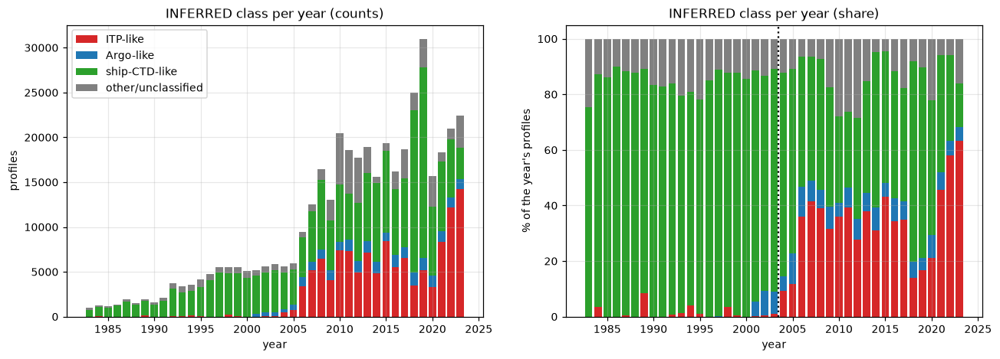

**Track statistics per inferred class** (tracks with >= 5 profiles)

| track class (INFERRED) | tracks | profiles in tracks | median profiles/track | median duration (d) | median step dt (d) | median drift speed (cm/s) | median extent (km) | median max depth (m) | median lat |
|---|---|---|---|---|---|---|---|---|---|
| ITP-like | 1,725 | 120,157 | 26.0 | 13.0 | 0.2 | 14.5 | 70.9 | 187.5 | 78.2 |
| Argo-like | 1,848 | 23,262 | 9.0 | 75.5 | 10.0 | 4.5 | 181.3 | 1,937.5 | 65.9 |
| fixed-point series | 32 | 1,356 | 35.5 | 9.9 | 0.2 | 7.1 | 7.6 | 45.0 | 78.6 |
| drifting shallow platform | 740 | 29,907 | 22.0 | 11.0 | 0.2 | 15.4 | 33.6 | 35.0 | 78.7 |
| other tracks (n>=5, unclassified) | 6,658 | 106,695 | 7.0 | 10.6 | 0.8 | 20.0 | 78.7 | 175.0 | 68.4 |

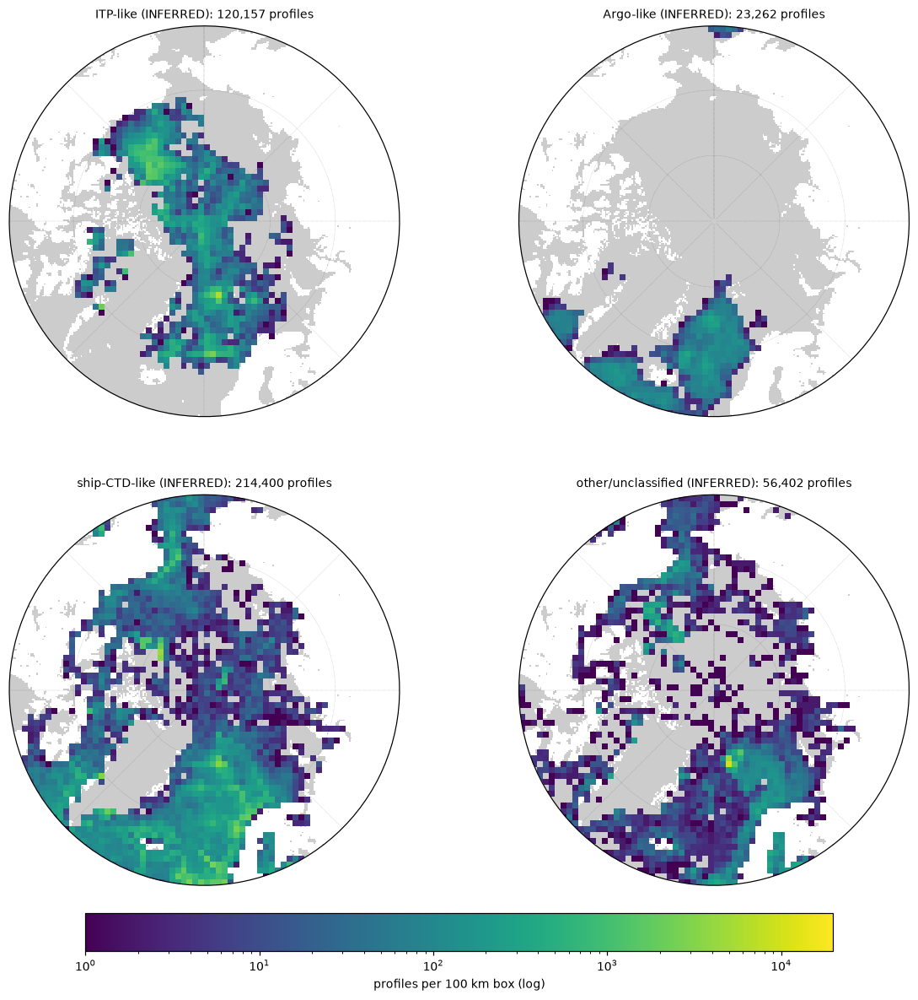

**Maximum depth by inferred class**

| class (INFERRED) | % >= 100 m | % >= 300 m | % >= 700 m | % >= 1000 m | % >= 1500 m | % >= 2000 m | % >= 3000 m |
|---|---|---|---|---|---|---|---|
| ITP-like | 84.0 | 62.6 | 55.1 | 0.8 | 0.4 | 0.1 | 0.0 |
| Argo-like | 99.8 | 98.9 | 96.7 | 92.0 | 69.8 | 10.4 | 1.0 |
| ship-CTD-like | 72.6 | 43.6 | 25.9 | 16.8 | 10.8 | 3.9 | 1.1 |
| other/unclassified | 34.3 | 1.0 | 0.9 | 0.1 | 0.1 | 0.1 | 0.0 |

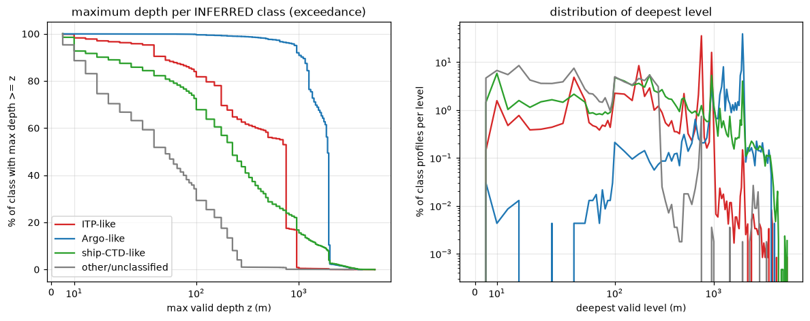

**Inferred class per region** (profiles; `tables/s6_class_per_region.csv`)

| region | ITP-like | Argo-like | ship-CTD-like | other/unclassified |
|---|---|---|---|---|
| Canadian Arctic Archipelago | 1,991 | 0 | 2,851 | 495 |
| Hudson Bay / Foxe Basin | 0 | 0 | 52 | 24 |
| Central Arctic (>80N: Nansen/Amundsen/Makarov) | 31,600 | 25 | 18,316 | 1,967 |
| Baffin Bay / Davis Strait | 5,126 | 84 | 10,057 | 1,197 |
| Fram Strait / Greenland Sea | 18,745 | 5,112 | 19,669 | 17,649 |
| Iceland Sea | 4,315 | 2,800 | 17,668 | 1,181 |
| Norwegian Sea | 11,439 | 7,246 | 45,273 | 2,559 |
| Barents Sea | 5,869 | 36 | 25,107 | 12,590 |
| Kara Sea | 92 | 0 | 318 | 367 |
| Laptev Sea | 87 | 0 | 730 | 264 |
| East Siberian Sea | 15 | 0 | 254 | 128 |
| Chukchi Sea | 633 | 0 | 8,396 | 2,317 |
| Beaufort Sea / Canada Basin | 39,623 | 0 | 10,626 | 7,492 |
| Bering Sea / Bering Strait | 0 | 180 | 4,151 | 645 |
| Labrador Sea / subpolar N Atlantic | 0 | 7,779 | 44,771 | 3,223 |
| Other | 622 | 0 | 6,161 | 4,304 |

### 6.3 Validation against known structure (weak, no ground truth)

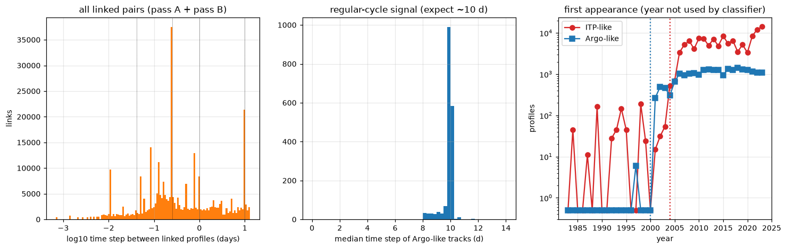

* The classifier does not use the year. ITP-like profiles first appear in **1984** (ITPs were first deployed in 2004), with 795 ITP-like profiles before 2004. Argo-like profiles first appear in **1997**, with 6 before 2000.
* 93.3% of Argo-like tracks have a median step of 9-11 d (regularity is built into the rule, so this is not independent); the histogram of all link steps (left panel) shows the structure independent of the classification: a short-step population from profilers and a ~10 d peak. Argo-like profiles have median latitude 67.5N and 98.8% lie in the Nordic seas / Barents / subpolar North Atlantic regions; 83.1% of ITP-like profiles are north of 72N.

### 6.4 Near-duplicates and exact copies still in the data

The published deduplication (`duplicate.m`) removed a profile of sources 2-7 only if an earlier-accepted profile lay within |dlat|<0.1, |dlon|<0.1 (raw degrees, no cos(lat) and no dateline wrap) and < 6 h (the manuscript says 5 h). Source 1 (ITP) was never tested, profiles within one input file were not tested against each other (the comparison list is built per file), so near-duplicates are expected to remain among ITP profiles and within a source's file.

| criterion | pairs | profiles involved | % of all profiles involved |
|---|---|---|---|
| pairs within 5 h (all, input to the tests) | 4,749,590 | 412,270 | 99.5 |
| pairs |dlat|<0.1, |dlon|<0.1, dt<6 h  (criterion as coded in upstream duplicate.m) | 437,714 | 177,584 | 42.9 |
| pairs |dlat|<0.1, |dlon|<0.1, dt<=5 h  (criterion as stated in the manuscript) | 393,453 | 169,467 | 40.9 |
|   same but with dateline-aware dlon | 437,718 | 177,588 | 42.9 |
| pairs within 1 km (haversine) and 1 h | 62,271 | 65,840 | 15.9 |
| pairs within 1 km and identical time stamp | 11,917 | 21,550 | 5.2 |
| pairs with identical lat, lon and time | 7,621 | 13,167 | 3.2 |
| pairs (6 h/0.1 deg criterion) with identical T arrays | 3,742 | 5,525 | 1.3 |
| pairs (1 km/1 h) with identical T arrays | 2,310 | 3,245 | 0.8 |

437,714 pairs (177,584 profiles, 42.9%) still satisfy the 0.1 deg / 6 h test; 62,271 pairs (65,840 profiles) lie within 1 km and 1 h. Of the 6 h pairs, 3,742 have bitwise-identical T arrays.

**Near-duplicate pairs by inferred class of the two members**

| row_0 | ITP-like | Argo-like | ship-CTD-like | other/unclassified |
|---|---|---|---|---|
| ITP-like | 103,876 | 10 | 2,881 | 841 |
| Argo-like | 4 | 102 | 82 | 2 |
| ship-CTD-like | 2,939 | 31 | 293,407 | 852 |
| other/unclassified | 898 | 0 | 788 | 31,001 |

**Clusters** (chains of profiles linked by the 0.1 deg / 6 h test)

| cluster size | clusters | profiles |
|---|---|---|
| 2 | 20,675 | 41,350 |
| 3 | 5,409 | 16,227 |
| 4 | 2,951 | 11,804 |
| 5-9 | 4,100 | 25,658 |
| 10-49 | 2,028 | 39,748 |
| >=50 | 258 | 42,797 |

There are 35,421 clusters of >= 2 profiles; the largest has 2,371 profiles. Largest clusters:

| cluster size | centre lat | centre lon | start | end | lat span (deg) | profiles with a duplicate-T twin | dominant inferred class | dominant region |
|---|---|---|---|---|---|---|---|---|
| 2,371 | 79.05 | -130.46 | 2023-01-04T18:33:00 | 2023-05-17T12:33:00 | 2.41 | 4 | ITP-like | Beaufort Sea / Canada Basin |
| 1,634 | 79.70 | -134.42 | 2022-10-08T08:33:00 | 2023-01-15T20:33:00 | 1.15 | 0 | ITP-like | Beaufort Sea / Canada Basin |
| 1,539 | 79.02 | -144.90 | 2022-12-11T00:33:00 | 2023-04-18T06:33:00 | 2.79 | 1,351 | other/unclassified | Beaufort Sea / Canada Basin |
| 1,068 | 69.20 | -168.50 | 2018-08-18T09:04:00 | 2018-08-28T09:15:00 | 0.88 | 0 | ship-CTD-like | Chukchi Sea |
| 1,034 | 70.00 | -165.60 | 2018-08-29T01:29:00 | 2018-09-11T16:17:00 | 0.98 | 0 | ship-CTD-like | Chukchi Sea |
| 1,008 | 78.27 | -129.57 | 2018-12-19T06:02:00 | 2019-02-11T20:47:00 | 0.62 | 493 | ship-CTD-like | Beaufort Sea / Canada Basin |
| 878 | 80.30 | -133.06 | 2022-10-13T10:33:00 | 2022-12-10T14:33:00 | 0.63 | 2 | ITP-like | Central Arctic (>80N: Nansen/Amundsen/Makarov) |
| 733 | 80.71 | -132.82 | 2018-10-26T06:02:00 | 2018-12-04T20:47:00 | 0.50 | 411 | ship-CTD-like | Central Arctic (>80N: Nansen/Amundsen/Makarov) |
| 691 | 79.26 | -142.14 | 2023-10-30T08:33:00 | 2023-12-18T06:33:00 | 1.31 | 0 | ITP-like | Beaufort Sea / Canada Basin |
| 649 | 78.74 | -132.98 | 2023-03-09T20:33:00 | 2023-04-15T12:33:00 | 1.29 | 0 | ITP-like | Beaufort Sea / Canada Basin |
| 623 | 79.28 | -121.67 | 2023-06-06T12:33:00 | 2023-07-18T04:33:00 | 0.36 | 0 | ITP-like | Beaufort Sea / Canada Basin |
| 618 | 79.00 | -131.19 | 2023-04-18T10:33:00 | 2023-05-22T12:33:00 | 0.25 | 0 | ITP-like | Beaufort Sea / Canada Basin |
| 589 | 70.66 | -162.29 | 2018-09-11T20:54:00 | 2018-09-17T06:24:00 | 0.23 | 0 | ship-CTD-like | Chukchi Sea |
| 558 | 78.46 | -130.97 | 2018-11-04T02:47:00 | 2018-12-05T00:02:00 | 0.57 | 299 | ship-CTD-like | Beaufort Sea / Canada Basin |
| 443 | 78.76 | 9.02 | 2019-07-13T08:09:00 | 2019-07-19T09:42:00 | 0.27 | 0 | ITP-like | Fram Strait / Greenland Sea |

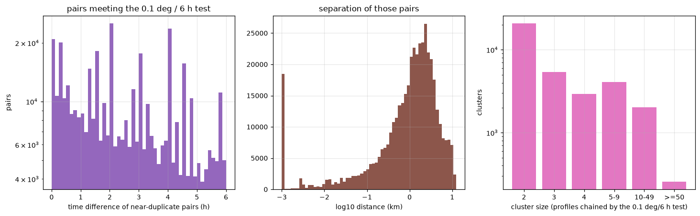

**Exact copies** (identical T array including the NaN pattern; computed with a hash of each profile)

| min valid levels | profiles considered | identical-T groups (size>=2) | profiles in such groups | redundant copies (profiles - groups) | largest group | groups: same lat,lon,time | groups: same lat,lon, different time | groups: different position |
|---|---|---|---|---|---|---|---|---|
| 1 | 414,221 | 5,712 | 22,097 | 16,385 | 71 | 891 | 100 | 4,721 |
| 5 | 370,676 | 1,694 | 3,751 | 2,057 | 19 | 852 | 46 | 796 |

16,385 profiles (all lengths) and 2,057 profiles with >= 5 valid levels are redundant exact copies (in 1,694 groups). Largest groups: `tables/s6_identical_T_top_groups.csv`.

## 7. Data-quality descriptors of what remains

All statistics use the normalised arrays (NaN = missing). Temperature is treated as in-situ temperature and salinity as practical salinity (an assumption: the files do not state it). Pressure comes from the per-profile `pres` array. Seawater properties were computed with `gsw` for **all 414,220 profiles with S** (no sub-sampling), in chunks of 20,000 profiles.

### 7.1 T and S per depth band

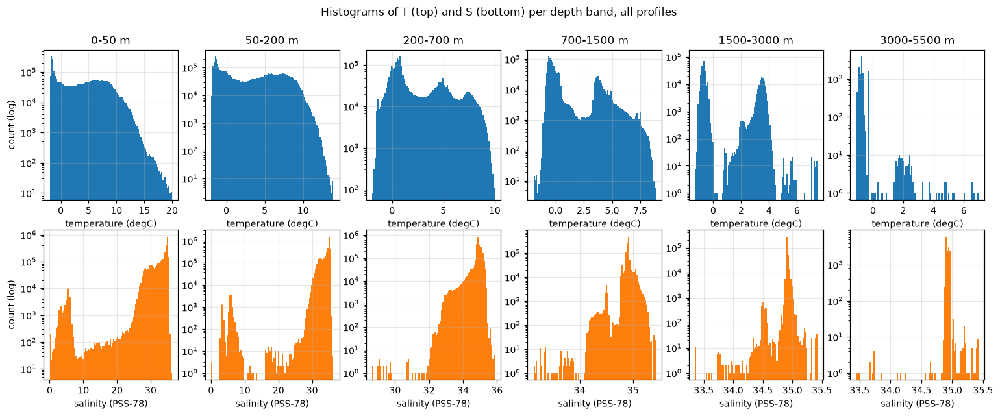

| depth band | T obs | T mean | T std | T min | T p1 | T p99 | T max | S obs | S mean | S std | S min | S p1 | S p99 | S max |
|---|---|---|---|---|---|---|---|---|---|---|---|---|---|---|
| 0-50 m | 3,171,786 | 3.33 | 4.17 | -2.00 | -1.82 | 12.21 | 19.97 | 3,171,785 | 32.75 | 4.10 | 0.01 | 5.60 | 35.34 | 36.33 |
| 50-200 m | 4,223,893 | 3.08 | 3.73 | -2.00 | -1.79 | 10.09 | 13.93 | 4,223,893 | 34.03 | 2.02 | 0.01 | 30.29 | 35.36 | 36.27 |
| 200-700 m | 2,856,007 | 2.51 | 2.72 | -1.93 | -1.27 | 8.72 | 9.99 | 2,856,007 | 34.88 | 0.30 | 28.66 | 33.44 | 35.29 | 35.86 |
| 700-1500 m | 1,137,206 | 0.97 | 2.12 | -1.94 | -0.88 | 6.94 | 8.88 | 1,137,206 | 34.91 | 0.08 | 33.14 | 34.52 | 35.13 | 35.43 |
| 1500-3000 m | 408,612 | 0.39 | 1.84 | -1.31 | -0.99 | 3.85 | 7.44 | 408,612 | 34.91 | 0.04 | 33.35 | 34.87 | 34.99 | 35.42 |
| 3000-5500 m | 14,383 | -0.70 | 0.39 | -1.10 | -1.06 | -0.25 | 6.97 | 14,383 | 34.92 | 0.05 | 33.45 | 34.89 | 34.97 | 35.43 |

### 7.2 Static stability

For each pair of adjacent valid levels the in-situ densities of both parcels were compared at the mid-pressure (`gsw.rho(SA, CT, p_mid)`); a pair is *unstable* if the upper parcel is denser than the lower by more than the stated threshold. Because the data are on a standard-depth grid, small inversions can reflect real mixed-layer noise or interpolation, so several thresholds are reported.

| threshold rho(k)-rho(k+1) (kg/m3) | adjacent-level pairs unstable | % of pairs | profiles with >=1 unstable pair | % of profiles with S |
|---|---|---|---|---|
| 0.001 | 341,441.000 | 2.996 | 113,130.000 | 27.312 |
| 0.010 | 29,384.000 | 0.258 | 20,814.000 | 5.025 |
| 0.030 | 6,503.000 | 0.057 | 5,338.000 | 1.289 |
| 0.100 | 376.000 | 0.003 | 332.000 | 0.080 |

| upper level in band | pairs | % pairs > 0.001 | % pairs > 0.01 | % pairs > 0.03 | % pairs > 0.1 |
|---|---|---|---|---|---|
| 0-50 m | 3,095,104 | 4.555 | 0.526 | 0.132 | 0.007 |
| 50-200 m | 4,124,975 | 2.807 | 0.243 | 0.046 | 0.002 |
| 200-700 m | 2,762,104 | 2.132 | 0.081 | 0.014 | 0.002 |
| 700-1500 m | 1,032,252 | 2.397 | 0.057 | 0.008 | 0.001 |
| 1500-5500 m | 383,231 | 0.273 | 0.071 | 0.016 | 0.001 |

Out of 11,397,666 adjacent-level pairs, 0.258% exceed 0.01 kg/m3 and 0.057% exceed 0.03 kg/m3. 5.02% of profiles with S have at least one pair above 0.01 kg/m3 and 1.29% above 0.03 kg/m3.

**By INFERRED class** (class is a heuristic label)

| class (INFERRED) | profiles with S | % unstable (>0.03 kg/m3) |
|---|---|---|
| ITP-like | 120,157 | 1.59 |
| Argo-like | 23,262 | 0.51 |
| ship-CTD-like | 214,400 | 1.06 |
| other/unclassified | 56,401 | 2.39 |

### 7.3 Freezing point and spikes

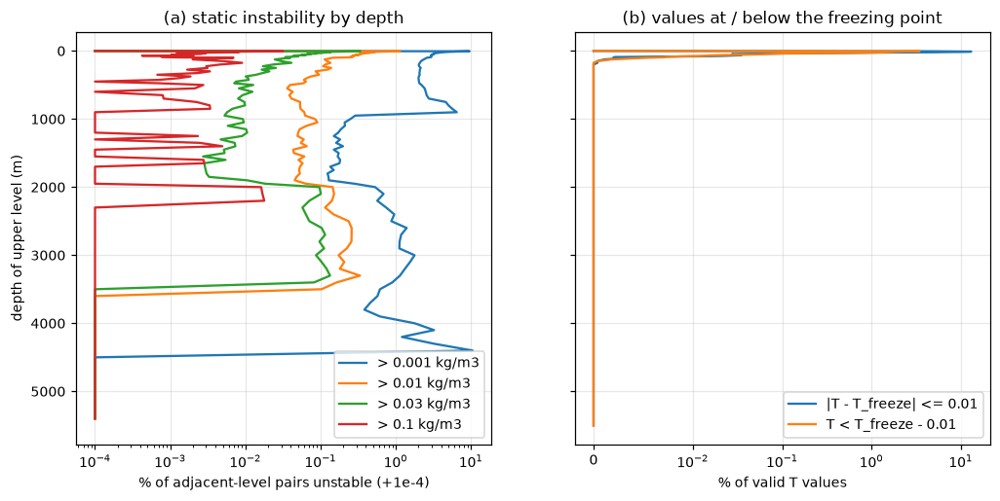

* Values within +/-0.01 degC of the in-situ freezing temperature (`gsw.t_freezing(SA, p, 0)`): **122,194** (1.03% of 11,811,886 valid T values with S); values more than 0.01 degC below freezing: 35,813 (0.303%). Exactly T = -2.0 degC: 41 values (the data minimum is -2.00 degC).

| test | pairs flagged | % of pairs | profiles flagged | % of profiles (with T resp. S) |
|---|---|---|---|---|
| |dT/dz| > 0.3 degC/m between adjacent valid levels | 34,719 | 0.305 | 27,978 | 6.754 |
| |dS/dz| > 0.2 per m between adjacent valid levels | 58,937 | 0.517 | 48,579 | 11.728 |

Per-level counts: `tables/s7_spikes_per_level.csv`, `tables/s7_freezing_point_per_level.csv`.

### 7.4 T-S diagram

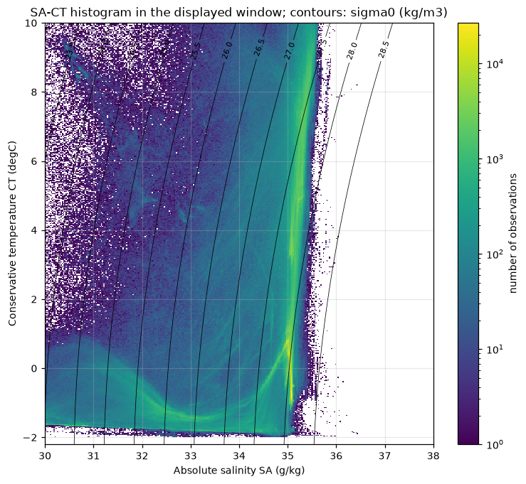

The diagram holds 11,118,410 observations (all valid levels, in the plotted SA/CT window). Outliers are not removed.

### 7.5 Mean and spread of T and S, 0-1500 m, in two basins

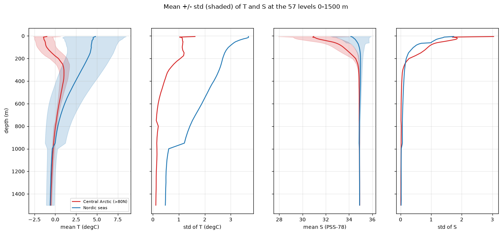

Central Arctic = the 'Central Arctic (>80N ...)' region of Section 5; Nordic seas = the Fram Strait/Greenland Sea, Iceland Sea and Norwegian Sea regions. The spread mixes years, seasons and locations and is not a measurement error.

**Nominal water-mass layers by depth range** (fixed depth boundaries, not property-defined)

| region | layer (nominal depth range) | T obs | T mean | T std | S mean | S std |
|---|---|---|---|---|---|---|
| Central Arctic >80N | Polar Mixed Layer (0-50 m) | 343,474 | -1.33 | 1.15 | 31.45 | 1.85 |
| Central Arctic >80N | Halocline (50-200 m) | 542,590 | -0.99 | 1.20 | 33.29 | 1.13 |
| Central Arctic >80N | Atlantic layer (200-900 m) | 498,668 | 0.73 | 0.64 | 34.82 | 0.14 |
| Central Arctic >80N | Intermediate (900-2000 m) | 26,910 | -0.44 | 0.21 | 34.91 | 0.02 |
| Central Arctic >80N | Deep / bottom water (>=2000 m) | 8,878 | -0.67 | 0.15 | 34.93 | 0.01 |
| Nordic seas | Polar Mixed Layer (0-50 m) | 1,237,465 | 4.55 | 3.51 | 34.46 | 1.30 |
| Nordic seas | Halocline (50-200 m) | 1,654,375 | 4.32 | 3.00 | 34.83 | 0.66 |
| Nordic seas | Atlantic layer (200-900 m) | 1,545,802 | 2.21 | 2.52 | 34.96 | 0.12 |
| Nordic seas | Intermediate (900-2000 m) | 678,568 | -0.45 | 0.74 | 34.90 | 0.03 |
| Nordic seas | Deep / bottom water (>=2000 m) | 47,839 | -0.83 | 0.21 | 34.91 | 0.03 |

## 8. Fitness for purpose

Ratings are computed by rule: each purpose has one coverage metric (percent of the 17.3 million km2 of 60-90N ocean in 100 km boxes meeting a stated sampling criterion). **Good** >= 60 %, **Marginal** 20-60 %, **Poor** < 20 %. The metric is an upper-bound indicator of coverage (it ignores seasonal, instrument and quality issues), so read each rating together with its comment. The denominator includes marginal seas (Hudson Bay, Baltic, Gulf of Alaska, ...) and shelves, which lowers all percentages; central-Arctic and Nordic-seas coverage is better than the area-wide numbers.

| purpose | metric (% ocean area) | rating | metric definition / evidence | comment |
|---|---|---|---|---|
| Gridded climatology 0-1500 m (monthly/seasonal) | 29.7 | Marginal | mean over the 4 WOA quarters of the % of 60-90N ocean area with >=10 T profiles at 500 m; by quarter: JFM 25%, AMJ 26%, JAS 36%, OND 33% | Needs large influence radii/smoothing; unconstrained in many boxes in at least one season. |
| Regional climatology of the Atlantic layer (north of 70N) | 51.7 | Marginal | % of ocean area >70N with >=10 profiles at 300 m (all years); 35,610 central-Arctic profiles reach >=200 m | Best in Eurasian Basin and Nordic seas where drifting-platform and ship profiles are dense. |
| Basin-scale deep (>2000 m) analysis | 12.8 | Poor | % of 60-90N ocean area with >=10 profiles at 2000 m (denominator includes shelves shallower than 2000 m, so a lower bound); 38,865 profiles (9.4%) have data below 1500 m | Deep data come mostly from ship CTD casts, mainly summer; Argo-like profiles stop at ~2000 m. |
| Mixed layer / near-surface (0-50 m) | 44.5 | Marginal | mean over quarters of % ocean area with >=10 profiles at 10 m (0 m is empty, 5 m partly filled); by quarter: JFM 36%, AMJ 36%, JAS 58%, OND 47% | 0 m is empty and 5 m only ~67% filled; summer/ice-free sampling bias dominates. |
| Halocline structure (50-200 m; needs S) | 62.3 | Good | % ocean area with >=10 S profiles at 100 m (all years) | Best-covered layer; fine vertical spacing, many INFERRED ITP-like profiles in the basins after 2004. |
| Interannual variability / trends | 40.1 | Marginal | % ocean area sampled in >=10 distinct years (not accounting for profiles per year or season) | Coverage shifts from sparse ship sections to drifting platforms and Argo, changing place and season. |
| Seasonal cycle in the central Arctic | 100.0 | Good | % of calendar months with >=100 central-Arctic profiles reaching >=200 m from >=10 distinct years; 12 of 12 months pass | Passes the count rule, but only 2.2% of central-Arctic profiles predate 2003; winter months rest on only ~15 years (mostly drifting platforms), so interannual and seasonal signals are confounded. |
| Eulerian time series at a point | 32.7 | Marginal | % ocean area in 100 km boxes with >=100 profiles, >=10 years, >=6 calendar months; INFERRED fixed-point series: 32 | Only few locations; most data are drifting or one-off stations. |
| Validation of models/reanalyses (point-wise, 1 deg) | 41.8 | Marginal | % of 1 deg ocean cells north of 60N with >=10 profiles (all years, all depths) | Subsample the model at the data locations/times instead of comparing with the mean state. |
| Ocean heat content 0-700 m | 41.3 | Marginal | % ocean area with >=10 profiles reaching >=700 m (all years); by decade: 1983-1992 7%, 1993-2002 13%, 2003-2012 32%, 2013-2023 32% | Needs profiles that reach 700 m; shallow drifting-platform profiles reduce effective coverage. |

**Central Arctic by calendar month** (profiles reaching >=200 m)

| month | central-Arctic profiles reaching >=200 m | distinct years (those profiles) | distinct years (any central profile) |
|---|---|---|---|
| Jan | 2,587 | 15 | 16 |
| Feb | 1,810 | 14 | 15 |
| Mar | 1,557 | 15 | 16 |
| Apr | 2,195 | 27 | 28 |
| May | 2,922 | 24 | 24 |
| Jun | 2,740 | 21 | 21 |
| Jul | 2,528 | 31 | 31 |
| Aug | 3,648 | 37 | 37 |
| Sep | 4,304 | 33 | 33 |
| Oct | 4,084 | 23 | 23 |
| Nov | 3,928 | 19 | 19 |
| Dec | 3,307 | 16 | 17 |

### Prose summary

* **Strengths.** 414,221 profiles with matched T and S; 29% of profiles are INFERRED ITP-like, giving dense sampling of the ice-covered basins after 2004 for the upper few hundred metres.
* **Weaknesses.** 11.0% of the 60-90N ocean area has no profile; only 72.2% has >=10 profiles; sampling shifts strongly between sea-ice seasons and decades; deep data are sparse.
* **Recommendation.** Use the data for regional/sectional studies of the upper 700 m and halocline since 2004, process studies and model comparison at profile locations. Use gridded climatologies, trend and deep-ocean studies only with an explicit sampling-bias assessment.

## Appendix: tables written

* `tables/s1_levels_per_profile_distribution.csv`
* `tables/s1_max_depth_exceedance.csv`
* `tables/s1_value_ranges.csv`
* `tables/s2_profiles_per_decade.csv`
* `tables/s2_profiles_per_month_of_year.csv`
* `tables/s2_profiles_per_season.csv`
* `tables/s2_profiles_per_year.csv`
* `tables/s2_profiles_year_x_month.csv`
* `tables/s3_box100km_counts.csv`
* `tables/s3_box_count_distribution.csv`
* `tables/s3_box_count_distribution_by_slice.csv`
* `tables/s3_grid_0.25deg_counts.csv`
* `tables/s3_grid_1deg_counts.csv`
* `tables/s3_latlon_grid_distribution.csv`
* `tables/s4_box_coverage_selected_depths.csv`
* `tables/s4_observations_by_depth_range.csv`
* `tables/s4_observations_per_level.csv`
* `tables/s5_median_max_depth_region_decade.csv`
* `tables/s5_region_definitions.csv`
* `tables/s5_regions.csv`
* `tables/s6_class_maxdepth_exceedance.csv`
* `tables/s6_class_per_region.csv`
* `tables/s6_class_per_year.csv`
* `tables/s6_class_summary.csv`
* `tables/s6_identical_T_summary.csv`
* `tables/s6_identical_T_top_groups.csv`
* `tables/s6_near_duplicate_cluster_sizes.csv`
* `tables/s6_near_duplicate_pairs.csv`
* `tables/s6_near_duplicate_pairs_by_class.csv`
* `tables/s6_near_duplicate_pairs_per_year.csv`
* `tables/s6_near_duplicate_top_clusters.csv`
* `tables/s6_subclass_summary.csv`
* `tables/s6_track_statistics_by_class.csv`
* `tables/s6_tracks_n_ge_5.csv`
* `tables/s7_TS_stats_per_depth_band.csv`
* `tables/s7_freezing_point_per_level.csv`
* `tables/s7_mean_std_57_levels_central_nordic.csv`
* `tables/s7_spikes.csv`
* `tables/s7_spikes_per_level.csv`
* `tables/s7_static_instability.csv`
* `tables/s7_static_instability_per_band.csv`
* `tables/s7_static_instability_per_class.csv`
* `tables/s7_water_mass_layers.csv`
* `tables/s8_central_arctic_monthly.csv`
* `tables/s8_fitness_for_purpose.csv`
