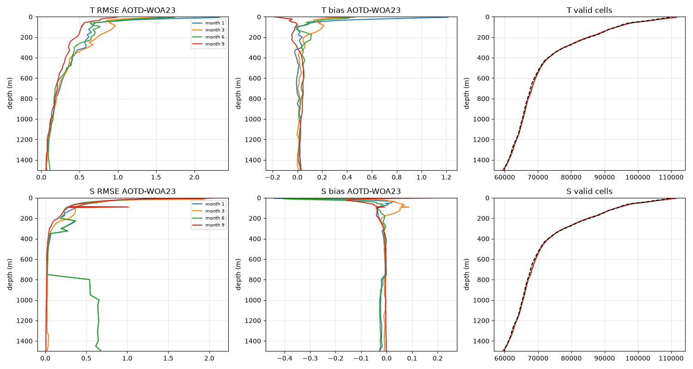
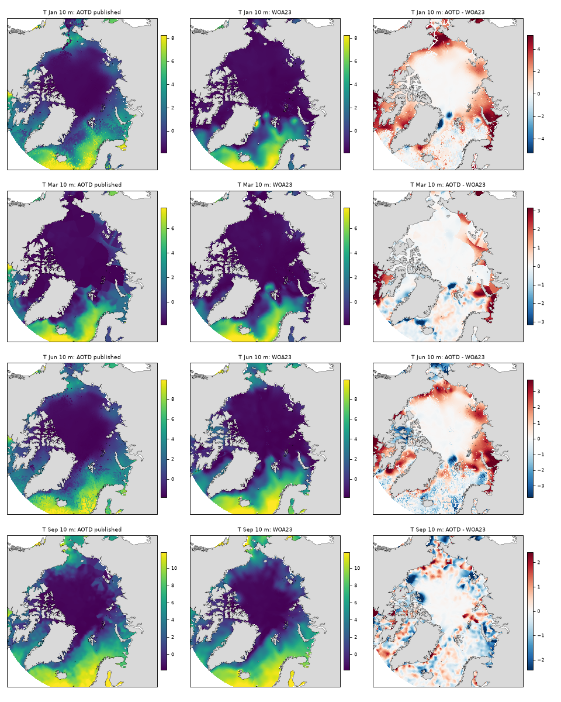
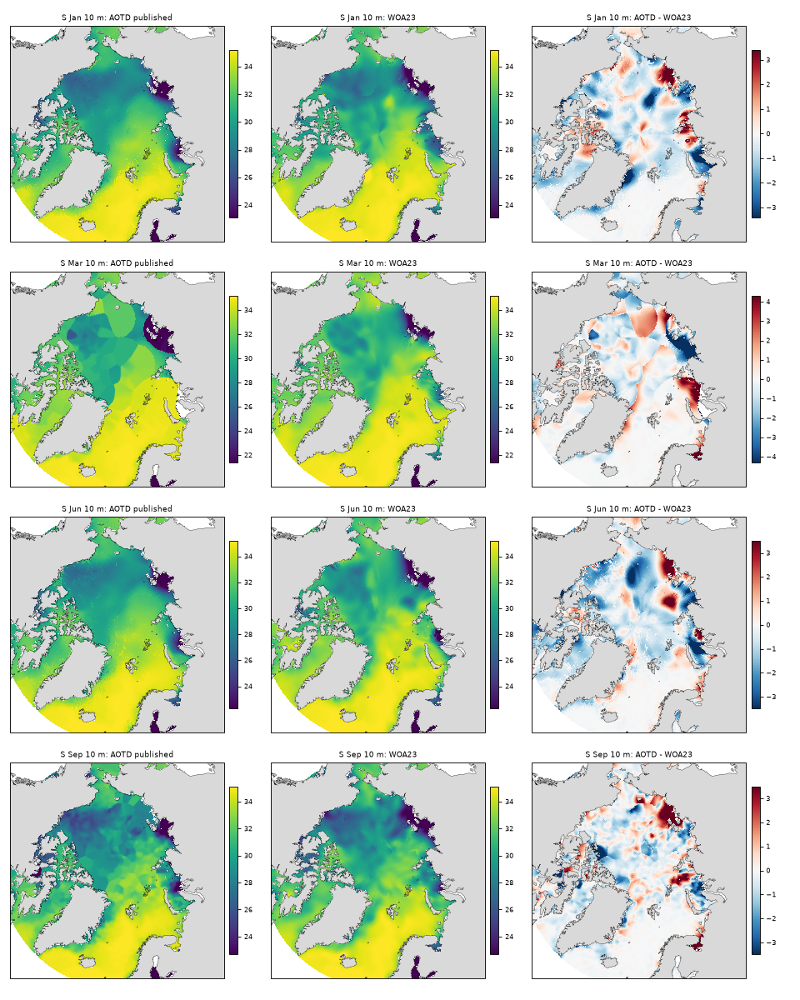
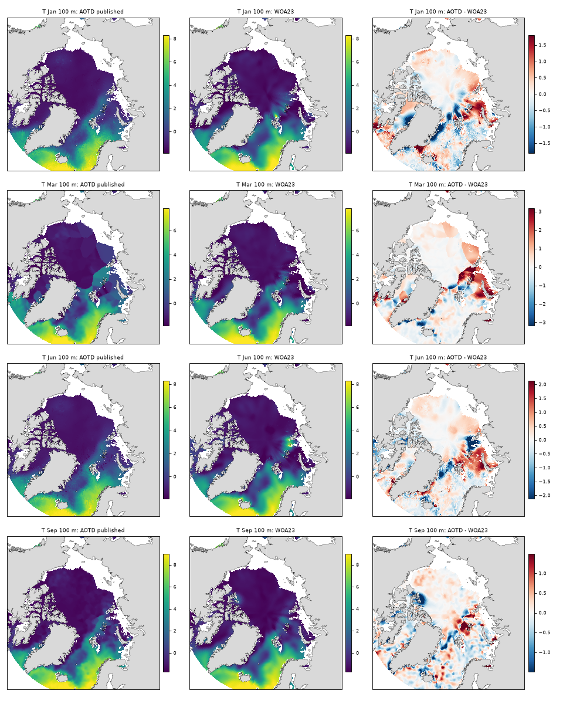
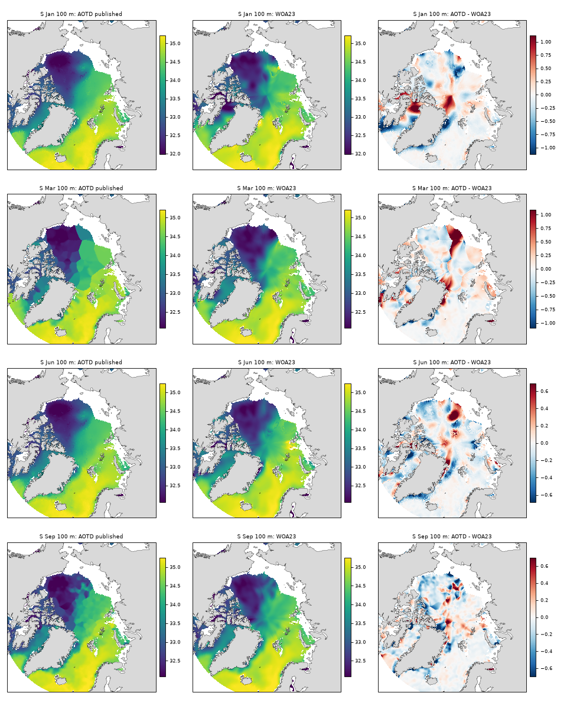
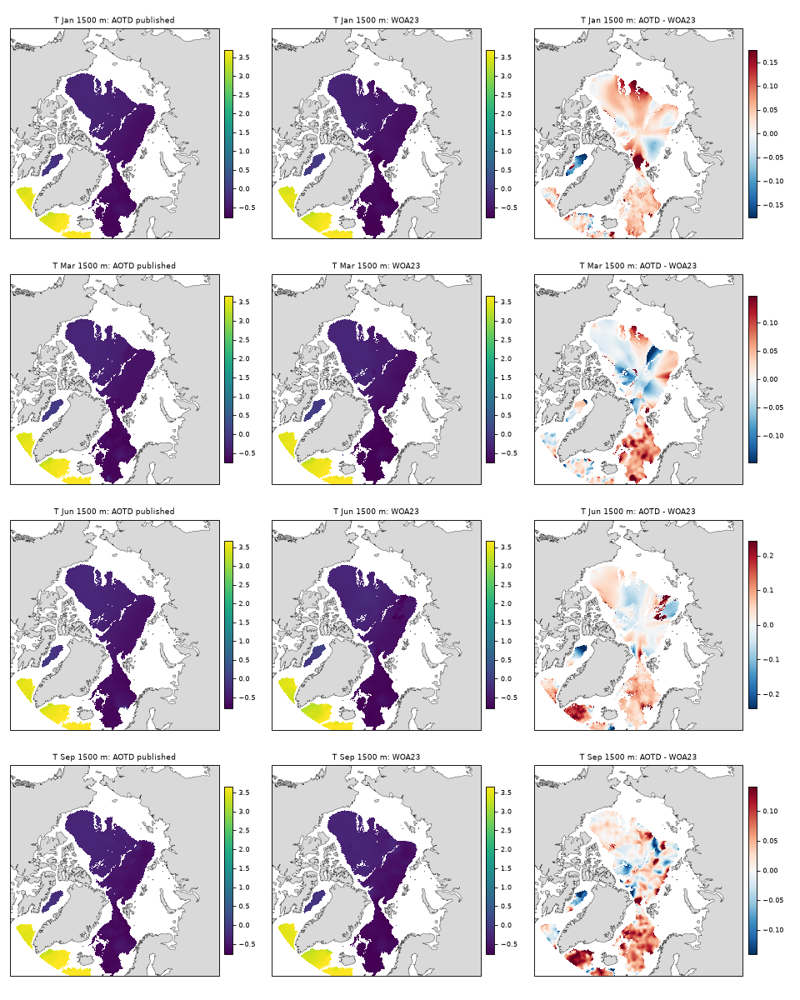
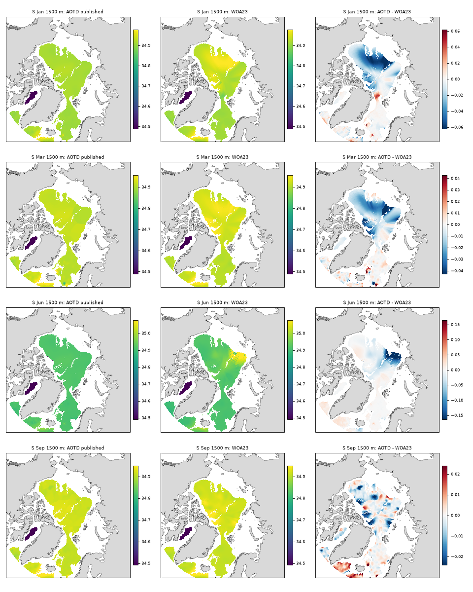

# Published AOTD and WOA23: monthly climatology comparison

Generated by `scripts/06_report_aotd_vs_woa23.py` from the local published climatology
files. See the [README](../../README.md) for reproduction, the
[technical note](../../technical_note.md) for assumptions, and the
[empirical-spread report](../expected_spread/expected_spread_report.md) for the
observation-minus-reference products.

## 1. Purpose and method

This is a **comparison of two analyses**, not an independent accuracy assessment.
Differences are AOTD minus WOA23. Temperature (T) here is treated as **in situ**
temperature, unlike the potential-temperature differences in the spread products.
Practical salinity (S) is conventionally labelled psu.

* WOA23: `decav91C0`, objectively analysed `t_an` and `s_an`, monthly, 0.25°,
  57 levels from 0 to 1500 m, reference period 1991–2020.
* AOTD: published monthly fields for the dataset spanning 1983–2023.
* Each monthly statistic uses cells finite in **both** fields at the selected depth.
  Because 0.25° latitude–longitude cells converge toward the pole, primary summary
  statistics (`rmse`, `bias`, `corr`) weight each cell by **cos(latitude)**; unweighted
  grid-index means (`rmse_unweighted`, `bias_unweighted`) are also recorded in the CSV.
  Masks may differ between months, variables and depths.
* Area-weighted RMSE = √(Σ w(AOTD − WOA23)² / Σ w); area-weighted offset (`bias` in the CSV) = Σ w(AOTD − WOA23) / Σ w, with w = cos(lat).
  Correlation is the cos(lat)-weighted spatial Pearson correlation on the same finite-cell intersection.
  Statistics require more than ten shared cells. These summaries are not sampling
  confidence intervals.

### Adopted grid alignment

The local AOTD files expose integer index coordinates rather than geographic cell
centres. For this analysis their 121 × 1440 arrays are assigned to WOA23 rows 599–719:
latitude centres 59.875–89.875°N and longitude centres −179.875–179.875°E.
The fields are then compared cell for cell, without regridding. Maps use these same
adopted coordinates.

The following **January mask diagnostic** compares finite-value masks at the adopted
alignment and tests integer row/column offsets from −3 to +3. Shift tests omit the
outer three latitude rows on each side and wrap longitude cyclically, so their
percentages are not directly comparable to the full-grid percentage.
Offsets describe sampling a displaced WOA row and rolling its columns, not a
geolocation correction.

| variable / depth | mask mismatch, full grid (%) | interior mismatch, zero shift (%) | best tested interior mismatch (%) | best row offset / column roll |
|---|---|---|---|---|
| T / 0 m | 2.36 | 2.42 | 2.42 | +0 / +0 |
| S / 0 m | 2.36 | 2.42 | 2.42 | +0 / +0 |
| T / 100 m | 2.02 | 2.07 | 2.07 | +0 / +0 |
| S / 100 m | 2.02 | 2.07 | 2.07 | +0 / +0 |

Mask agreement supports the adopted correspondence, but cannot resolve a fractional
cell shift or establish the intended AOTD geolocation. No independent confirmation
of that alignment is provided here.

## 2. Monthly statistics by depth

Each entry below is the **median of monthly statistics** in its group, not an RMSE
pooled across months. March and September are shown separately to describe the
observed monthly contrast; this is a descriptive, post hoc grouping, not a test of
its cause. Masks are determined separately for every monthly comparison.
T quantities are in °C; S quantities are in psu.

| depth (m) | T RMSE Mar/Sep | T RMSE other 10 | T offset other 10 | S RMSE Mar/Sep | S RMSE other 10 |
|---|---|---|---|---|---|
| 0 | 1.32 | 2.11 | +1.01 | 2.04 | 1.86 |
| 10 | 1.18 | 1.83 | +0.87 | 1.48 | 1.39 |
| 50 | 0.75 | 0.78 | +0.15 | 0.56 | 0.50 |
| 100 | 0.74 | 0.64 | +0.00 | 0.32 | 0.27 |
| 300 | 0.48 | 0.46 | +0.02 | 0.07 | 0.19 |
| 500 | 0.32 | 0.34 | +0.02 | 0.03 | 0.03 |
| 750 | 0.20 | 0.20 | +0.03 | 0.02 | 0.02 |
| 800 | 0.19 | 0.19 | +0.02 | 0.02 | 0.54 |
| 1000 | 0.13 | 0.14 | +0.02 | 0.02 | 0.66 |
| 1500 | 0.06 | 0.08 | +0.03 | 0.01 | 0.68 |

The unrounded values, per-field counts (`n_aotd`, `n_woa`) and intersection counts
(`n_both`) are in [the level-statistics CSV](tables/level_stats.csv).

## 3. Figures

**Figure 1. Monthly comparison statistics at 0–1500 m.** Rows: T and S.
Columns: difference RMSE, mean offset and valid-cell counts. Lines show January,
March, June and September; the dashed count curve is WOA23 in January.
Counts in the last column describe each field separately, whereas RMSE and offsets
use their intersection.

**Figure 2. AOTD, WOA23 and their difference at selected depths.** Each figure
has rows for January, March, June and September. The first two columns share
a colour range within each row (pooled 1st–99th percentiles); difference ranges
are symmetric about zero (98th percentile of absolute differences). Scales can
differ between rows. All fields are plotted at the adopted WOA23 centres.

| depth | temperature | salinity |
|---|---|---|
| 10 m |  |  |
| 100 m |  |  |
| 1500 m |  |  |

## 4. Findings and interpretation

1. **Differences depend strongly on depth and month.** The table shows larger
   near-surface RMSEs than at depth for temperature. Surface temperature offsets
   also vary by monthly group. A pooled group median should not be interpreted
   as an offset present in every month or location.
2. **Deep salinity merits targeted investigation.** In the ten-month group,
   salinity RMSE increases sharply between 750 and 800 m and remains much larger
   at 1000 and 1500 m than in March/September. This is a documented disagreement
   between products. Its cause and the relative accuracy of the two fields have
   not been established by this comparison.
3. **Consequences for the spread products are conditional.** Reference differences
   can change the empirical observation-minus-reference metrics where profiles
   sample the affected cells. A large climatology-to-climatology RMSE does not
   directly determine the magnitude of the profile-based spread or its combined
   maximum.

Potential explanations include different input sampling, reference periods, analysis
methods and grid interpretation. These are hypotheses, not attributions established
here. WOA23 is an analysed reference rather than truth. AOTD scatter and climatology
share source observations, and the extent of overlap with WOA23 is not quantified;
neither comparison constitutes an independent holdout validation.

## 5. Reproduction and attribution

Run `python scripts/06_report_aotd_vs_woa23.py` from the repository root after
downloading the reference files. It regenerates this report, the
[level statistics](tables/level_stats.csv),
[mask diagnostics](tables/mask_alignment.csv), and linked figures. The extracted
WOA23 cache is `outputs/woa/woa_on_aotd_grid.npy`; remove it if changing the source
files or extraction convention.

AOTD: Li, J., Wu, X. & Wang, X. (2025), *An Arctic Ocean Thermohaline Dataset*,
[doi:10.1038/s41597-025-05855-3](https://doi.org/10.1038/s41597-025-05855-3);
published climatology,
[doi:10.6084/m9.figshare.27645738.v1](https://doi.org/10.6084/m9.figshare.27645738.v1).
WOA23: Locarnini et al. (2024), *Temperature*, NOAA Atlas NESDIS 89; Reagan et al.
(2024), *Salinity*, NOAA Atlas NESDIS 90,
[NOAA NCEI](https://www.ncei.noaa.gov/products/world-ocean-atlas).
